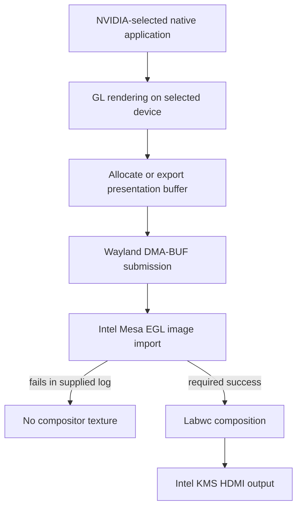

# NVIDIA Quadro P520, native Wayland and Debian Preseed: evidence-based audit and repair report

**Audit date:** 24 November 2026  
**Inputs:** `logs.zip` and `debian-preseed.zip` supplied in this conversation  
**Primary objective:** make explicitly selected NVIDIA acceleration work for native Wayland applications on the Intel + Pascal laptop, while retaining the PikaOS repository and the existing confinement model.  
**Deliverable status:** source/log audit, upstream research and implementation instructions. No change was installed on the laptop. Hardware acceptance tests have not been executed.

### Navigation

- [Executive findings](#executive-findings)
- [1. Scope and evidence](#1-scope-coverage-and-evidence-conventions)
- [2. Hardware, software and failure sequence](#2-reconstructed-hardware-software-and-failure-sequence)
- [3. NVIDIA rendering and the repair decision](#3-nvidia-rendering-precise-diagnosis-and-repair-strategy), including [the authoritative exec-mode contract](#310-the-existing-exec-mode-is-authoritative)
- [4. PikaOS and Pascal package policy](#4-pikaos-and-pascal-package-policy)
- [5. Every AppArmor denial](#5-apparmor-every-denial-and-its-correction)
- [6. Application, desktop, diagnostic and hardware errors](#6-application-desktop-diagnostic-and-hardware-error-ledger)
- [7. Firstboot, preseed and installation speed](#7-firstboot-preseed-package-selection-and-installation-speed)
- [8. Implementation, acceptance and rollback](#8-implementation-order-acceptance-and-rollback)
- [9. Coverage and error-resolution index](#9-coverage-and-error-resolution-index)
- [10. Primary research bibliography](#10-primary-research-bibliography)

## Executive findings

The blank-window failure is located at a specific boundary: **the Intel/Mesa Labwc compositor cannot import the DMA-BUF images submitted during the NVIDIA-selected Vivaldi launch**. The repeated `eglCreateImageKHR → EGL_BAD_MATCH → Failed to create texture → Failed to upload buffer` sequence is a failed client-buffer import, before Labwc has a usable texture to compose. It is not explained by the adjacent focus messages. The earlier HDMI atomic-commit error belongs to a different operation and time. [L01; L02; L03]

The source explicitly selects NVIDIA rendering for NVIDIA exec mode: it chooses NVIDIA GBM/EGL, normalizes Chromium's render node, and keeps other GPUs metadata-only inside the sandbox. Preserve that selection contract. The compositor and active display use Intel, so the selected NVIDIA application must export a presentation buffer Intel can consume. The evidence identifies this failed handoff; it does not justify changing the application to Intel or software rendering. [C01; C02; C03]

**The logs prove the failed handoff, but they do not contain the rejected client's FOURCC, modifier, plane layout or DMA-BUF exporter identity.** Consequently, they do not establish whether the decisive failure is buffer allocation/export compatibility, an inaccessible presentation device, or an application/driver-specific import defect. There is no defensible basis to promise that one environment variable will repair every native application. This report supplies exact corrections for the proven defects and a short decision procedure that identifies the remaining graphics fix without another cycle of unrelated tuning.

The priority actions are:

1. Correct the named NVIDIA helper transitions and the other AppArmor defects listed in §5. Keep enforcement enabled. These are proven policy defects; removing them is necessary cleanup, not proof of a graphics cure.
2. Preserve the **selected exec mode and actual renderer** throughout the native launcher. Correct buffer allocation/export or presentation transport while retaining NVIDIA rendering in NVIDIA mode. For Chromium/Electron, selecting Intel GBM can also select Intel GL; it is not a valid NVIDIA-mode repair. Section 3.10 specifies the existing mode contract and source protections to retain. [S03; S04]
3. Capture one failing NVIDIA launch using the repository's existing `wayland-graphics` diagnostic workflow. It already parses client buffer layouts. Compare a single Intel control launch with a single NVIDIA launch; use the results to select the repair branch in §3.7.
4. Preserve the PikaOS source, its signature verification, and the coherent **580 proprietary** package family. NVIDIA's exact 580.196.07 supported-device list includes P520 PCI ID `1D34`; the open kernel-module flavor does not support Pascal. Do not replace the driver with an open/Turing-only branch. [S01; S02]
5. Fix firstboot's service-lifecycle classifier, menu Glycin permissions/error handling, process exit-status translation, collector path traversal, and the additional issues in §§6–8.
6. Move deterministic source/schema/render consistency checks to artifact creation. Consume a prevalidated frozen payload in d-i; retain checks of actual downloads, package-manager results, mounts, devices, boot artifacts and runtime health. The current final installer validator is already a no-op. The stale offline bundle must be regenerated separately. [C10; I01]

### Severity and certainty

| ID | Priority | Finding | Certainty | Corrective direction |
|---|---|---|---|---|
| GPU-01 | High | Blank native Vivaldi surfaces fail at Intel EGL DMA-BUF import | Confirmed failure boundary | Capture actual buffer layout; correct the selected presentation path, not focus or cursor handling |
| GPU-02 | High | NVIDIA-selected Chromium requires a working NVIDIA-to-Intel buffer handoff | Selection and topology confirmed; failing allocation/layout not captured | Preserve NVIDIA selection; repair export/import compatibility or implement a real presentation bridge |
| SEC-HELPER | High | NVIDIA helper execution is denied in compositor and application profiles | Confirmed, 24 records | Correct the named transition and use an appropriate confined application-helper execution policy |
| FB-01 | High | Firstboot classifier rejects three inactive obligations using an incomplete lifecycle model | Classifier defect and getty conflict confirmed; two invocation states need inspection | Lifecycle-aware expectations; keep actual service failures visible |
| PKG-01 | High future risk | Pika family selection needs an explicit Pascal-compatible branch contract | Source-level upgrade risk, not evidence of a current ABI mismatch | Constrain branch and package cohort while retaining Pika origins |
| OFF-01 | High reproducibility risk | Offline payload is internally valid but stale | Confirmed | Regenerate offline artifacts from the same release as online products |
| SEC-DCONF | Medium | Greeter dconf directory creation denied | Confirmed, 180 records | Grant owner-scoped runtime directory rights |
| SEC-ALIASES | Medium | Tuning worker has stale numeric NVIDIA device-alias permissions | Confirmed, 30 records | Derive exact aliases from validated device identity; preserve one writer |
| SEC-MODCONF | Medium | Swap/zram modprobe cannot read canonical NVIDIA config targets | Confirmed, 12 records | Read-only access to exact canonical configuration paths |
| MENU-01 | Medium | Glycin temporary-file creation crashes the menu popup | Confirmed, 1 denial plus uncaught icon load | Narrow temporary-file/loader policy and a text-only error fallback |
| PROC-01 | Medium | Negative subprocess return codes can become misleading positive service statuses | Confirmed source defect; `247` is consistent with `-9`, not proof of who killed it | Preserve signals or normalize at the executable boundary |
| PROC-02 | Medium | Expected-close handling does not cover the captured `foot -e nmtui` case | Confirmed missing case; intent of close needs correlation | Exact lifecycle classification, never blanket-success exit code 1 |
| OBS-01 | Medium | Diagnostic collector opens traversal-only directories for reading | Confirmed source/permission mismatch | Secure `O_PATH` traversal; readable final directory only when enumerating |
| DISP-01 | Investigate if recurring | One Intel HDMI atomic commit returns `EBUSY` | Confirmed incident, cause not captured | Correlate output transaction/pageflip; retain atomic modesetting |
| UI-01 | Low | Vendor desktop-entry load failures and Waybar cursor warnings | Messages confirmed; actual vendor file bodies and exact deployed parser not supplied | Respect desktop metadata semantics and installed Waybar schema |

## 1. Scope, coverage and evidence conventions

### 1.1 What was examined

Both archives were safely inventoried and extracted without executing their contents. The log archive contains **4,792 regular files, 23,669,394 bytes**. The source archive contains **2,696 regular files, 97,558,816 bytes**, of which 2,685 decode as UTF-8 text. A complete byte-read/hash inventory was made. The text includes approximately 1,109,107 newline-delimited lines, much of it generated manifests, hardware research data and repeated build products; this is not a claim of a million lines of handwritten implementation.

The work combined complete file inventory/content processing with deduplication, error-family classification and semantic review of the relevant execution paths. In the runtime portion alone, 4,708 files reduce to 681 distinct contents; 306 files are empty. The security portion contains 25 files, including the full 51,701-line auditd log. Repeated snapshots were correlated rather than counted as independent incidents.

The user-excluded private compatibility subsystem was not audited or proposed for modification. References to it in shared files do not expand this report's scope. All graphics repair instructions concern native Wayland applications and their shared launcher paths.

The source review covered the installer dispatcher and class machinery, suite inputs, target templates and hooks, native application launch/sandbox/network/lifecycle code, desktop/session/output management, AppArmor policy, firstboot, diagnostics, package/repository handling, and generated/offline artifact provenance. Large research/data inputs were inventoried and parsed as data; they were not treated as executable code or as evidence of current renderer behavior.

### 1.2 Verification actually performed

Static checks parsed **591 Python source/template files** with Python 3.12.14's AST parser and **337 shell source/template files** with `dash -n`. They passed. These checks do not import repository modules, execute installation scripts, prove target Python compatibility, validate every runtime substitution, or exercise the GPU. Perl compile mode was not used indiscriminately because `BEGIN` blocks can execute code.

The current Forky and Trixie release products were compared with their recorded source inputs, compiler inputs, frontend inputs and payload members. Their frozen payload contents match the corresponding current manifests. The offline bundle was inspected independently and is stale; see §7.

No installer, package installation, target service, AppArmor reload, GPU benchmark, browser reproduction, module load, firmware update, power change or destructive storage command was run on the laptop. The hardware measurements in this report come from the supplied logs. Commands below are explicitly **operator-side next steps**, not checks claimed to have passed here.

### 1.3 How to read evidence references

`logs/` denotes the root of the extracted log archive. `repo/` denotes `debian-preseed.bak/` inside the source archive. Line references count newline characters; audit records contain other control separators that must not be mistaken for new lines.

| Reference | Supplied evidence |
|---|---|
| L01 | `logs/journalctl`, especially 1355–1404, 2387–2410, 2407–2772 and 2784 |
| L02 | `logs/managed/system/debugsys/20261124T211114Z-report-3f07e44d/evidence/1771-gpu-compositor-unit-journal.txt` |
| L03 | Same evidence directory, `1769-gpu-wayland-protocols.txt` and `1768-gpu-outputs.txt` |
| L04 | Same evidence directory, `1641-gpu-drivers.txt`, `1642-gpu-nvidia.txt` and `1786-packages.txt` |
| L05 | `logs/managed/security/apparmor/apparmor.log` and `logs/managed/security/audit/auditd.log` |
| L06 | `logs/managed/apps/apps.log` |
| C01 | `repo/d-i/debian/hooks/target/usr/local/lib/desktop/python3/dist-packages/labwc_managed_app/gpu.py`, especially 86–145 and 228–241 |
| C02 | Same Python package, `mounts.py`, especially 41–48 and 101–140; `profiles.py.tmpl`, 8–17 |
| C03 | Same Python package, `runtime.py`, 28–68; `browsers.py`, 72–168; common consumers in `cli.py`, `sandbox.py`, `generic.py` and `electron.py` |
| C04 | `repo/d-i/debian/hooks/target/usr/local/libexec/desktop/labwc-session-check`, especially 35–68 and 139–217 |
| C05 | `repo/d-i/debian/hooks/target/usr/local/bin/desktop/labwc-session.tmpl`; `repo/d-i/debian/hosts/profiles/desktop/shared-de.env`, 127–136, and `btrfs-de-p15s{,-duo,-trio}.env` in that directory |
| C06 | `repo/d-i/debian/hooks/target/usr/local/libexec/desktop/labwc-debug-session`, 280–390, 435–565; `usr/local/bin/desktop/labwc-main-menu.tmpl`, 277–302 and 584–609 |
| C10 / I01 | Installer and firstboot source/log references are expanded in §7 |

External source identifiers `[Sxx]` resolve to primary upstream documentation, code or issue trackers in the research bibliography. An upstream issue on a different GPU/driver is supporting context, not proof that this laptop has that exact bug.

## 2. Reconstructed hardware, software and failure sequence

### 2.1 Actual captured platform

| Component | Captured value | Implication |
|---|---|---|
| Intel GPU | PCI `0000:00:02.0`, `8086:9b41`, i915 | Actual compositor renderer and display owner |
| NVIDIA GPU | PCI `0000:2d:00.0`, `10de:1d34`, GP108GLM / Quadro P520 | Pascal discrete GPU; proprietary NVIDIA driver bound |
| Render nodes at capture | Intel `renderD128`; NVIDIA `renderD129` | Enumeration observed in this boot; never hard-code as vendor identities |
| Primary nodes at capture | Intel `card1`; NVIDIA `card0` | `card0` is not synonymous with the display-owning GPU |
| Active output | Intel `HDMI-A-2`, 1920×1080 at 120 Hz; eDP disabled | HDMI commit is an Intel KMS operation in this session |
| NVIDIA driver family | `580.196.07-101pika2` | Preserve coherent proprietary 580 family for Pascal |
| NVIDIA GBM EGL platform | `libnvidia-egl-gbm1` `1.1.4-101pika1` | Present, not simply missing GBM support |
| NVIDIA Wayland EGL platform | `libnvidia-egl-wayland1` `1:1.1.24-101pika1` | Already contains the 1.1.24 release level; do not prescribe an upgrade from 1.1.23 as a new fix |
| Mesa | `26.3.1-101pika1` | Pika Intel compositor userspace |
| Labwc / wlroots | `0.20.3-1` / `0.20.2-1` | Diagnose this stack rather than obsolete wlroots recipes |
| Kernel | `7.3.1-x64v3-xanmod1` | Current package/driver compatibility must be evaluated as a cohort |
| Vivaldi | `8.3.4191.47-1` | Exact browser package known; embedded Chromium revision was not independently established |
| Chromium | `156.0.8078.79-1` | Separate installed browser, not proof of Vivaldi's embedded revision |
| NVIDIA VA-API adapter | `0.0.18-1` | Recent version includes upstream Chromium-related work; older blanket statements about no Chromium support are stale |
| Waybar / foot | `0.15.0-1+b2` / `1.28.0-1` | Use installed-version option and exit semantics |

Evidence: L02–L04, including package-list lines 68–69, 282, 448, 705–707, 809, 1283–1284, 1753, 1878, 1979–1997 and 2384–2385.

The NVIDIA XML snapshot reports 2,048 MiB total VRAM, 54 MiB reserved, 1,189 MiB used and 807 MiB free. The sole listed process is `whisper-server`, PID 8033, with about 1,186 MiB allocated. That snapshot was taken after the failed browser had exited. It establishes a substantial concurrent compute allocation, not the absence of any earlier graphics context and not a demonstrated OOM cause. Do not kill that process or infer memory exhaustion from this snapshot alone.

### 2.2 Timeline

| Time on 24 November | Evidence and interpretation |
|---|---|
| 21:47:16 | `firstboot.service` fails after the selected-unit-state check; this precedes the graphics launch |
| 21:48:07–08 | Compositor selects Intel, `/dev/dri/card1`, `/dev/dri/renderD128`, GLES2; EGL vendor Mesa and GL renderer Intel are logged |
| 21:48:48 | Tomat menu popup cannot create a Glycin temporary file; AppArmor records the matching denial |
| 21:49:33 | One `HDMI-A-2` atomic commit fails with `EBUSY`; this predates the NVIDIA Vivaldi launch by over two minutes |
| 21:51:44 | Managed Vivaldi launch requests NVIDIA, starts its service and persistent sandbox |
| 21:51:47 | First repeated Intel EGL image-import failure appears while Vivaldi configures its surface |
| 21:51:47–21:52:04 | 90 repeated EGL import-error chains are recorded; these are repeated consequences of one failure family |
| 21:52:10 | Vivaldi managed service reports exit failure; wrapper status 247 needs correct signal/exit interpretation |
| 22:02:26–29 | `foot -e nmtui` launches, receives HUP, then its service reports exit code 1 |

The repeated `seat client ... != focused client`, `The surface is already focused`, and no-seat focus-request messages are not evidence that a GPU buffer is malformed or that focus caused the blank window. A client missing the 100 ms configure response deadline may be busy or stalled; increasing that deadline cannot make an unimportable DMA-BUF renderable.

### 2.3 The relevant data path



The application's GL vendor, its allocation device, the compositor's renderer, and KMS output ownership are not interchangeable facts. A correct NVIDIA GL context alone does not prove presentation works. A visible window alone does not prove NVIDIA rendered it.

## 3. NVIDIA rendering: precise diagnosis and repair strategy

### 3.1 What `EGL_BAD_MATCH` establishes

`eglCreateImageKHR` is being used to turn a client DMA-BUF into a compositor EGL image. The operation needs an acceptable format and consistent dimensions, plane file descriptors, strides, offsets and modifiers. The logged failure means that this import operation did not produce an image. The following texture and upload errors are downstream effects. [S05]

The compositor feedback capture advertises `linux-dmabuf` version 4, an Intel main device, and an Intel tranche. Its formats include linear, Intel modifiers and the implicit/invalid modifier sentinel. It also exposes the explicit-sync manager. **The advertised list does not show which format/modifier the failed client actually submitted.** Nor does an advertised format guarantee that every buffer allocated by a different vendor with that nominal layout is importable. [L03]

Distinguish these cases:

| Candidate cause | What would establish it | What the supplied logs establish |
|---|---|---|
| Unsupported or incorrect FOURCC/modifier/plane layout | Actual client's buffer-params trace plus compositor format support and exporter information | Missing client layout; hypothesis remains open |
| Required selected-GPU device/control endpoint cannot be opened in the application sandbox | Same-credential, same-namespace open/ioctl failure on the exact required node | Helper exec denials are captured; a necessary selected-device open failure is not captured |
| Driver export/import defect despite valid common layout | Minimal native client reproduces outside the application wrapper, with valid layout and no relevant denials | Plausible, not proved |
| NVIDIA helper/policy failure during initialization | Matching denial and corresponding failed helper operation | Denials are proved; helper argv and impact on this buffer path are not |
| Synchronization defect | Image import succeeds, but explicit-sync/fence/commit evidence fails | Current leading error is image creation; sync is not the first demonstrated failure |
| VRAM exhaustion | Failed allocation with relevant driver/kernel evidence at failure time | Only later VRAM snapshot; no corresponding captured OOM/Xid proof |
| Intel output atomic-commit failure | Repeated KMS/pageflip sequence correlated with blank surfaces | One earlier, separate `EBUSY`; not a demonstrated cause of these import errors |

### 3.2 Exact native-launcher behavior to change

In `gpu.py`, `Selection.apply_environment()` at 104–122 applies all of the following to any NVIDIA-selected native client:

```text
GBM_BACKEND=nvidia-drm
__EGL_VENDOR_LIBRARY_FILENAMES=/usr/share/glvnd/egl_vendor.d/10_nvidia.json
__NV_PRIME_RENDER_OFFLOAD=1
LIBVA_DRIVER_NAME=nvidia
NVD_BACKEND=direct
NVD_DRM_DEVICE=<NVIDIA render node>
MOZ_DRM_DEVICE=<NVIDIA render node>
```

`chromium_arguments()` at 125–145 additionally inserts `--render-node-override=<NVIDIA render node>`. `add_binds()` at 86–102 exposes other DRM nodes with a read-only nodev bind and the selected GPU with device-enabled binds. The same policy is used by plain, persistent-sandbox, generic and Electron paths. `profiles.py.tmpl` also contains NVIDIA environment entries; changing only one of these owners would leave conflicting behavior in another path. [C01–C03]

**Required contract:** keep the validated PCI-based selection as the application renderer. Distinguish the application's rendering identity from the compositor's consuming device in diagnostics and buffer negotiation. That distinction is not permission to select a second renderer or introduce a mixed-GPU browser mode.

For Chromium, preserve the selected NVIDIA render-node override, NVIDIA EGL implementation and usable NVIDIA device bindings. The other render nodes are deliberately metadata-only so libdrm can identify compositor feedback without allowing an accidental renderer change. Their nodev status is **not a proven defect** in this GBM path. Do not turn Intel into a device-enabled application binding as a speculative fix.

For a different native EGL platform implementation, a presentation allocator may have its own device requirements. Establish those from an actual device-open trace and the implementation before changing its exact binding contract. If an implementation requires an additional presentation endpoint, its design must still preserve the requested NVIDIA GL renderer; it cannot be used to silently move application rendering to Intel. No such necessary failed open is captured for Vivaldi here.

**Access qualification:** successful `stat`, `access()` or `O_PATH` discovery does not prove that the selected renderer can use its device. Check the real `O_RDWR` open and EGL operation under the final UID, supplementary groups, namespaces, cgroup device policy and AppArmor profile. Keep the existing identity protections. `O_PATH` is a traversal tool, not a GPU-readiness test.

The proven source corrections are the helper confinement defects, the software-only toolkit/profile contradictions described below, and accurate lifecycle/diagnostic reporting. The two graphics-environment definitions should be consolidated so future backend-specific changes have one owner, but their current equal values do not prove they caused the buffer failure. The selected browser's actual format, modifier and exporter must determine the transport repair. [C01–C03]

### 3.3 Native EGL applications: the repair branch

Native EGL applications using an actual Wayland EGL surface can use NVIDIA's Wayland platform implementation to negotiate presentation differently from Chromium's GBM-backed Ozone path. For these clients:

1. Keep NVIDIA offload/render selection explicit.
2. Select the appropriate native platform for that application while retaining NVIDIA GL. A Wayland-EGL-specific change must not be assumed to change Chromium's GBM platform. Review allocator variables per backend; merely unsetting one is not a demonstrated repair.
3. If the platform implementation needs a separate presentation allocation endpoint, prove that requirement and retain NVIDIA rendering. Do not apply this as a blanket Chromium device-access change; its direct GBM path does not gain a copy implementation from an extra bind.
4. Keep optional decoder activation separate from the ordinary GUI comparison. Any accelerated decoder policy must honor the same explicitly selected GPU; do not redirect it to the other vendor.
5. Verify the initialized **GL renderer**, not just the presence of `libEGL_nvidia.so`, policy JSON or environment variables.

This is a backend-specific repair investigation, not a demonstrated fix for Vivaldi. The current archive lacks the before/after device-open and buffer-layout trace needed to select it. Vivaldi's Chromium/Ozone path must be evaluated separately.

The installed egl-wayland version is already **1.1.24**. NVIDIA's 1.1.24 release fixes the reported PRIME regression introduced in 1.1.23; simply recommending that version is not a new resolution here. The related upstream report includes a GP108 hybrid system, which makes it useful context, but this system has the later library. [S06; S07]

NVIDIA's newer `egl-wayland2` implements the Wayland EGL external platform with a newer driver interface and can coexist with the previous library; NVIDIA documents driver 560+ and appropriate DMA-BUF/explicit-sync requirements. The captured 580 driver and compositor protocol set make it a **reasonable native-EGL comparison candidate**. Its availability and exact package name in the user's signed Pika repository were not verified. Do not invent an `apt install` package name or replace packaged libraries by copying an upstream build over them. Inspect actual candidates and dependency changes, then test one packaged cohort. This does not promise to change a Chromium process that initializes EGL through GBM. [S08]

### 3.4 Chromium/Electron: why common PRIME recipes are insufficient

Upstream Chromium changed Ozone/Wayland so the selected GBM device is also supplied to EGL/ANGLE for GL initialization. The stated purpose is to put composition and allocation on the same device. Another upstream change prefers the compositor's render device for normal Wayland selection. [S03; S04]

Therefore:

- `--render-node-override=<Intel>` is not a verified way to get **NVIDIA rendering with Intel allocation**. It can select Intel for both.
- Removing that override may choose Intel. It must not be used as an NVIDIA-mode repair. Use the existing explicit Intel action only for the separately labelled control run.
- Keeping the NVIDIA override and merely unsetting `GBM_BACKEND` does not establish a new allocation strategy. The explicit NVIDIA file descriptor still matters.
- Selecting `__GLX_VENDOR_LIBRARY_NAME` does not repair a native EGL image-import failure.
- Adding an Intel render-node bind does not create a presentation-copy implementation and is not prescribed for NVIDIA-selected Chromium.
- `--disable-gpu` or SwiftShader makes a software comparison, not successful NVIDIA acceleration.
- `--disable-gpu-compositing` and `--disable-gpu-rasterization` violate the accelerated-mode contract and are explicitly rejected by the current argument validator. Preserve that rejection; do not recommend either as the NVIDIA fix.
- Disabling all explicit sync, all modifiers, all atomic KMS, or all application sandboxes at once destroys the diagnostic comparison and is not justified by these logs.

The existing policy already chooses ANGLE/OpenGL and disables Vulkan and Skia Graphite (`runtime.py`, 28–68). A Vulkan suggestion would change the current application backend policy; it is not a harmless prerequisite. There is no evidence here that enabling Vulkan universally solves the import failure, and no need to change it to correct the proven policy bugs.

For fully accelerated Chromium/Electron on NVIDIA with an Intel compositor, the **actual requirement** is that the client allocate/export presentation buffers that Intel can import, or provide a supported copy/readback bridge while keeping NVIDIA responsible for rendering. If the exact NVIDIA GBM path cannot do that on this package cohort, a launcher flag cannot manufacture the missing interoperability. The correct fix is a verified application/driver/library update or an application transport change, retained as a Pika-packaged, Pascal-compatible cohort.

An NVIDIA upstream issue describes GBM buffers that fail cross-vendor use and explicitly distinguishes which allocation/copy combinations work. Its original reproducer uses an RTX A400 and open 580.119.02 modules, whereas this laptop is Pascal with proprietary modules. It establishes that linear layout alone is not a universal cross-GPU guarantee; it **does not establish that this P520 has that same kernel bug**. [S09]

### 3.5 Do not confuse 3D rendering with video decoding

The shared launcher injects NVIDIA VA-API variables and the browser profiles request accelerated video features. Those are separate from the EGL import needed to display the browser's ordinary GUI.

Version-sensitive research matters here: Chromium disabled NVIDIA VA-API by default in April 2026 and provides `VaapiOnNvidiaGPUs` as an explicit override. Subsequently, upstream `nvidia-vaapi-driver` **0.0.18**, which is the installed release, added Chromium-related direct-backend/export changes. It would be inaccurate to repeat an older categorical claim that this installed adapter can never work with Chromium. It would be equally inaccurate to claim that those changes prove this P520's video path works. [S10; S11; S12]

Resolution:

1. Establish working ordinary GUI presentation first with video-decoding overrides absent from that comparison.
2. Add an explicit, per-browser decoder policy only after the window works.
3. If NVIDIA decoding is requested, check the actual embedded Chromium build's feature support and the `0.0.18` direct backend. Its documented opt-in includes `AcceleratedVideoDecodeLinuxGL` and `VaapiOnNvidiaGPUs`; the latter is not made effective by merely selecting the NVIDIA render node.
4. Verify the active decoder in the browser's media diagnostics and correlate decoder-engine activity. Browser GPU-feature listings alone are not evidence that a playing video uses NVDEC.
5. If decode fails, preserve the selected NVIDIA 3D path and report the unavailable video feature explicitly. Do not redirect the browser to Intel or label software decoding as NVIDIA decoding. A codec issue and a GUI presentation failure require separate evidence.

The existing `QTWEBENGINE_CHROMIUM_FLAGS` globally includes `--disable-gpu`. Applications using that policy cannot claim fully accelerated QtWebEngine merely because the outer launcher says NVIDIA. Likewise, a profile explicitly selecting Cairo is not evidence of GPU-rendered GTK content. Describe the real per-application backend in the UI and diagnostics.

**Precise same-GPU decoder correction:** the three NVIDIA browser profiles in `browsers.py:85–94,108–117,128–137` omit `VaapiOnNvidiaGPUs`. For a shipped browser version that implements that feature, add it to the NVIDIA decoder feature list after GUI presentation works. `VaapiIgnoreDriverChecks` is not its replacement. Where the browser supports `--hardware-video-device-path`, derive that value and `--render-node-override` from the **same validated NVIDIA `Selection.node`**. Extend normalization to strip/replace caller-provided instances of both switches while preserving operands after `--`. This enforces the selected mode; it does not create another GPU role. Do not treat the repository's `NVD_DRM_DEVICE` assignment as proof of device pinning: that control is not established in the inspected upstream adapter interface. [S10; S12; S14; S15]

The current graphics mount plan includes the selected NVIDIA render node and control/GPU nodes, but not UVM. An independently enabled NVDEC path may need a validated `/dev/nvidia-uvm`; establish its actual required access and prepare it on the host before the app starts. Adding UVM is not a demonstrated native OpenGL import fix. If video initialization needs to be isolated once, the managed command below disables only accelerated video decoding while retaining the NVIDIA GUI mode:

```sh
/usr/local/bin/labwc-app nvidia vivaldi --disable-accelerated-video-decode
```

Use a fresh Vivaldi process after normal close. This is a diagnostic comparison, not the final acceleration policy. The command's option is accepted by the inspected argument validator; acceleration-disabling GUI/composition flags remain rejected. The supplied logs do not contain a `vaInitialize`, `vaapi_wrapper`, `libva` or `gbm_create_device` failure proving that video initialization caused this blank window.

For QtWebEngine, `environment.py:1122` reapplies `MANAGED_NO_VULKAN_ENVIRONMENT` after the app's `final_env`, so an app-level override there cannot cancel the global `--disable-gpu`. Move that software-only choice out of the global dictionary into the explicit per-application fallback/capability policy. Keep required Vulkan exclusions and sandbox settings, and let explicit hardware mode initialize its selected GPU. This is a proven mode inconsistency for applications honoring the QtWebEngine variable; standalone Vivaldi does not use it.

### 3.6 One bounded capture, using the code already present

Do this on the laptop as the logged-in desktop user, after closing the selected browser normally so that an old single-instance process cannot consume the launch without the new diagnostic environment:

```sh
/usr/local/bin/labwc-main-menu --debug=wayland-graphics
```

Select the affected application's **NVIDIA action**. The menu uses the same managed launch path and a private, bounded collector; it is not a sandbox bypass. The collector normally runs for up to **120 seconds**, and its terminal can finish the bundle early. The archive path is published by the collector under:

```text
$XDG_RUNTIME_DIR/labwc-debug/<session>/diagnostic-bundle.tar.gz
```

The useful files are `dmabuf-layouts.json`, the captured client output, `processes.json`, `toolkits.json`, `service-journal.json`, `compositor-journal.json` and the recorded GPU/environment policy. The source already parses `linux_buffer_params` additions and creation requests into dimensions, FOURCC, plane offsets/strides and modifier high/low words. Its opt-in `diagnostics.py:17–20` already enables `WAYLAND_DEBUG=client` and `__NV_GBM_TRACE_ENABLED=1`; no global session tracing or new installer probe is needed. Preserve capture boundaries and timestamps; a process-local FD number in a protocol trace is not an exporter identity by itself. [C06]

Repeat once using the **Intel action** for the same application, profile state and window operation. Do not change compositor renderer, monitor refresh, decoder flags and driver versions simultaneously. A cold-start comparison must actually produce a new application service and GPU process.

If the native EGL comparison still needs to distinguish sandbox access from driver behavior, collect a short, targeted trace of the newly launched application's own process tree under its existing confinement. Limit it to device opens and the relevant helper exec attempt; retain only a private bounded trace. The auditd `PROCTITLE` records do **not** reveal the arguments of the denied `nvidia-modprobe` exec, so `-u`, `-m` or `-c` requirements must not be guessed. Do not turn off Chromium's internal sandbox as a shortcut.

For an independently selected simple native EGL probe, first check which Wayland-capable test binary is actually installed (`command -v es2gears_wayland` is a read-only check). Run it through the corrected native launcher where possible. A standalone `glxinfo` result would not test this native Wayland presentation path.

### 3.7 Decision table: what to fix after the capture

| Observed bounded result | Exact next correction | Success evidence |
|---|---|---|
| A necessary selected NVIDIA node/control open fails in final confinement | Repair only the proven missing host readiness, exact bind or profile permission; retain selected identity and sandbox | The same NVIDIA renderer initializes and presents without the corresponding access failure |
| Client submits a modifier/FOURCC not valid for Intel import | Correct the application's selected format/modifier negotiation or use a compatible packaged platform implementation; select a supported common layout rather than lying about a tiled buffer's modifier | Trace shows actual changed valid layout and successful import/presentation |
| Multiple-plane buffer metadata is inconsistent | Fix the exporter/plane metadata for that application or library version; preserve all FDs, strides, offsets and plane relationships | Identical content renders with structurally valid planes; no import error |
| A correctly described linear NVIDIA allocation still fails Intel import outside wrapper restrictions | Treat as a vendor/interoperability defect; test a documented Pika-packaged compatible cohort or implement a real presentation bridge | Same minimal reproducer and app succeed on the replacement cohort; renderer remains NVIDIA |
| Native Wayland EGL works but Chromium GBM still fails | Keep the successful EGL route for those applications; isolate Chromium/ANGLE/GBM package or transport repair | Chromium-specific fix validated independently; do not regress working EGL clients |
| Import succeeds but frames fail after sync/commit | Investigate the measured sync path then; change one explicit-sync variable only for a documented application issue | Correct frame ordering, resize and presentation without fence/protocol failure |
| NVIDIA mode becomes visible only after selecting Intel node for GL | Label it Intel; do not count it as NVIDIA success | Actual NVIDIA renderer must be restored before accepting NVIDIA mode |
| Only a software-composition mode works | Keep the NVIDIA mode unresolved; do not bypass the managed rejection of acceleration-disabling arguments | Full NVIDIA rendering and composition must work before accepting the repair |

This decision procedure has a stop condition. Once the actual layout/device-opening evidence selects a branch, stop trying unrelated environment flags. Escalation to a package maintainer should include the exact GPU IDs, proprietary 580 cohort, compositor identity, one minimal reproducer, and the buffer layout—not a generic full-system log dump without the failing client transaction.

### 3.8 Alternative compositor topology is a separate engineering change

Rendering the compositor on NVIDIA could remove the application's NVIDIA-to-Intel import at that particular stage, but this laptop's physical display still belongs to Intel. Cross-device transfer then moves elsewhere in the output pipeline. That is not automatically a cure.

The current `labwc-session-check` accepts only `LABWC_COMPOSITOR_GPU=auto|intel`; `nvidia` is rejected. An instruction to export `LABWC_COMPOSITOR_GPU=nvidia` would therefore be nonfunctional against this source. A real implementation would need a new validated mode, corresponding schema/profile handling, explicit renderer/KMS separation, and output-path acceptance tests. It is a larger fallback design, not the first patch and not something silently enabled for all users.

### 3.9 Acceptance criteria for “NVIDIA acceleration works”

For each application advertised as NVIDIA-capable, require all of the following in one bounded run:

1. A new managed process starts with the intended identity and confinement.
2. The initialized rendering backend reports NVIDIA/P520 rather than Intel, llvmpipe or SwiftShader. Policy labels and loaded filenames are supporting evidence only.
3. The window draws changing content, resizes, occludes/unoccludes and remains responsive on the active Intel output.
4. No matching EGL import/texture/upload error or new relevant AppArmor denial occurs.
5. Normal close completes the app's service and owned children; crash/signal behavior remains accurately reported.
6. Hardware decoding, if claimed, passes a separate decoder check.

Perform these tests after the repair on the laptop or a matching hardware fixture. They are not additional work to run during every unattended installation.

### 3.10 The existing exec mode is authoritative

The repair must preserve the application's existing mode contract. There is no proposed mixed-GPU Chromium mode. Intel and NVIDIA actions remain distinct, and an NVIDIA action must not become an Intel-rendered or software-composited browser to make the window visible.

The source already implements several correct guarantees:

| Existing behavior | Source in `labwc_managed_app/` | Preserve in the repair |
|---|---|---|
| `auto` resolves the configured managed default | `cli.py:242–245`; `environment.py:322–333` | Resolve once; retain requested and effective mode in the event record |
| Explicit acceleration is rejected when unavailable | `environment.py:336–338` | Fail clearly instead of choosing another vendor |
| `launch` follows the normal-launch selection | `gpu.py:148–219` | Do not redefine it as a new acceleration mode |
| `intel`/`nvidia` select a validated PCI/driver identity | `gpu.py:148–241` | Keep identity validation; never treat node numbering as vendor identity |
| Chromium's render-node argument is normalized to the selected GPU | `gpu.py:125–145` | Keep the NVIDIA node for NVIDIA mode and Intel node for Intel mode |
| Acceleration-disabling overrides are rejected | `commands.py:145–159` | Retain rejection of `--disable-gpu`, `--disable-gpu-compositing` and `--disable-gpu-rasterization` in accelerated modes |
| Native applications retain ANGLE/OpenGL and Wayland | `commands.py:114–158`; `runtime.py:28–68` | Do not silently change platform, renderer API or sandbox policy |

The compositor's Intel identity describes the already-running desktop. It is not a second application renderer selected by this repair. An NVIDIA application must produce pixels on NVIDIA and deliver them in a form that the existing compositor can consume. That delivery is the failing boundary.

#### 3.10.1 Effective NVIDIA browser contract

Preserve this effective intent:

```text
requested/effective exec mode = nvidia
validated application PCI GPU = 0000:2d:00.0 on this machine
actual GL renderer            = NVIDIA Quadro P520
render-node-override          = the validated NVIDIA render node
EGL/ANGLE backend             = the managed NVIDIA OpenGL path
application device access     = selected NVIDIA nodes and necessary controls
compositor                    = existing Intel Labwc session
```

The observed NVIDIA render node is `/dev/dri/renderD129`; keep resolving it from PCI identity. Do not replace it with Intel's node, remove the override to let the compositor default choose Intel, or inject a video-device selector pointing at another GPU. Do not broaden Chromium's application device access to Intel as a speculative cure: opening another device does not implement a copy path.

Graphics policy should have one final writer. Build the application environment and arguments, resolve the selected GPU, apply its selectors once, then serialize them into the same managed service. The existing common `Selection` already provides much of this. In the persistent path, `sandbox.py:1918–1922` applies it after environment construction. Preserve that ordering. Record actual backend identity after startup; policy values alone cannot prove that a browser avoided its own software fallback.

#### 3.10.2 What a real presentation repair must accomplish

There are two valid outcomes for NVIDIA mode:

1. **Direct transport works:** NVIDIA renders into a correctly described, exportable buffer whose memory and format/modifier are usable by the Intel compositor. The compositor imports and samples it successfully.
2. **A real presentation bridge works:** the application/platform implementation retains NVIDIA rendering and copies completed pixels into a compositor-compatible allocation before submission. Allocation, synchronization, lifetime and buffer-release handling belong to that implementation.

A bridge is an engineering change in the application/platform/driver path. It is not supplied by changing a policy label, selecting Intel GL, misreporting a modifier or disabling GPU composition. This audit has not identified a stock Chromium switch that guarantees such a bridge for the captured P520/Pika stack. A candidate package or source change must pass the actual failing transaction with the NVIDIA renderer retained.

If transport remains broken after the exact policy fixes, preserve an explicit NVIDIA-mode failure and its evidence. Do not mark that mode fixed because a different mode works. The user may deliberately select Intel through its existing action, but that is a separate choice and does not satisfy NVIDIA acceptance.

#### 3.10.3 Repository corrections justified now

- Apply the AppArmor/helper/readiness repairs in §5. They resolve demonstrated access failures without changing the GPU selection.
- Preserve PCI selection, the NVIDIA render override, native platform and existing argument rejection. Do not remove these protections while investigating import compatibility.
- Consolidate duplicated graphics-environment definitions in `profiles.py.tmpl` and `gpu.py` into one canonical owner. Equal duplicate values are a maintenance risk, not proof of the current rendering fault.
- Separate optional video-feature enablement from ordinary GUI initialization while retaining the same selected GPU. A GUI comparison should not depend on a decoder opt-in. NVIDIA decoding, when requested, must use NVIDIA and pass its own capability test.
- Correct the unconditional QtWebEngine `--disable-gpu` behavior and explicit Cairo policies wherever the UI offers an accelerated action: provide a validated accelerated backend or report that application's accelerated mode as unavailable. A software-only profile under an NVIDIA label violates the requested contract.
- Capture the real client/compositor buffer transaction and preserve child-signal reporting. These make the eventual transport fix measurable without adding repeated preseed probes.

Final acceptance requires actual NVIDIA rendering, correct visible pixels on the existing Intel desktop, and clean lifecycle behavior under confinement. Any remaining import failure means the NVIDIA rendering mode remains unresolved.

### 3.11 If direct export is defective: the concrete implementation boundary

This branch applies only if the captured descriptor and a focused reproducer establish that a correctly configured NVIDIA allocation cannot be consumed by Intel. A different buffer modifier, helper permission or unrelated output flag must not be credited as a fix without changing that failing operation.

The known NVIDIA GBM issue linked in S09 includes a reduced allocation/import test and reports failures even for nominally linear buffers. A later native Chromium/Intel-compositor reproduction has the same `EGL_BAD_MATCH` wording. Those machines use other GPU generations and open modules, and their scatter-gather/ENOMEM evidence is absent here. Use the report to choose a focused reproducer, not to declare the Pascal proprietary driver guilty by resemblance. Do not run a reproducer that can hang a display in an unattended install or an active production session. [S09]

**An application-side hardware-rendered readback transport is a technically concrete fallback design that preserves the selected GPU.** The application would keep NVIDIA EGL/ANGLE, GPU rasterization and GPU composition, read the completed final framebuffer into a bounded shared-memory buffer, and submit that buffer to Wayland. Intel would consume ordinary shared-memory pixels in its existing compositor. The application would not create an Intel GL renderer. Copying completed pixels is distinct from replacing application rendering with a software compositor.

Chromium has relevant implementation building blocks. In the inspected source revision, `GLOzoneEGLWayland::CreateViewGLSurface()` selects `GLSurfaceEglReadbackWayland` for software GL, while the accelerated GBM branch uses `GbmSurfacelessWayland`. Consequently, the existence of the readback class is not evidence that a stock NVIDIA-mode flag selects it. The exact shipped Chromium/Vivaldi branch must be inspected before porting a change. [S16]

The readback implementation creates shared-memory buffers in `Resize()`, calls `ReadPixels()` during `SwapBuffersAsync()`, commits them through the Wayland buffer manager, and tracks submission/presentation and destruction. That supplies concrete code to study for a hardware adaptation; it is not an already validated P520 patch. [S17]

If the direct export defect is confirmed and no compatible packaged fix exists, the engineering change must cover these points:

| Implementation owner | Required behavior |
|---|---|
| Ozone surface/presenter selection | Select a dedicated hardware-rendered readback presenter without selecting software GL or changing the NVIDIA EGL display |
| Viz/Skia and shared-image allocation | Keep rasterization/composition resources on NVIDIA; stop requiring the final window buffer to be a foreign-imported NVIDIA GBM allocation |
| Final image transfer | Read the completed NVIDIA framebuffer into a bounded pool, with validated dimensions/stride and correct format, alpha, orientation and scaling |
| Synchronization and ownership | Wait for completion before publishing pixels; honor Wayland submission/release and presentation callbacks; never reuse an in-flight buffer or leak a fence/FD |
| Resize, occlusion and close | Retire old buffers safely, bound outstanding frames and callback queues, and clean the owned resources when the service exits |
| Package/release integration | Build against the exact maintained browser source outside d-i; publish a reviewed package/artifact while retaining the required Pika driver/Mesa repository policy |

This is more work than changing a shell variable, but it addresses the actual buffer boundary while honoring NVIDIA mode. It should be pursued only after the direct-path evidence selects it; a compatible direct export fix is preferable when available. No browser build or hardware adaptation was implemented or tested in this audit.

The transfer has a measurable cost. A full 1920×1080 BGRA frame is 8,294,400 bytes. At 120 complete frames per second, the payload alone is about **995 MB/s** in decimal units, before staging, synchronization and compositor upload. Damage tracking and lower effective frame rate can reduce that amount. These figures are arithmetic for a hypothetical full-screen transport, not measured P520 throughput or a promise of smooth 120 Hz operation. Keep the actual selected mode truthful while measuring the resulting latency, power and frame delivery.

## 4. PikaOS and Pascal package policy

PikaOS must remain configured. The captured NVIDIA and Mesa components are already Pika builds. The report does not recommend removing that repository, replacing it with a generic distribution branch, or manually overwriting packaged libraries.

The current logs show a functioning NVIDIA module and a broadly coherent `580.196.07-101pika2` userspace family. There is no captured NVML version-mismatch or module-initialization failure that justifies a wholesale driver reinstall. Successful compute use does not prove native window presentation, but it is evidence against a simple “NVIDIA is not loaded” diagnosis.

NVIDIA's documentation for this exact driver lists P520 `1D34` and requires the proprietary module flavor for Pascal. The open flavor requires Turing or newer. Installing an open module, a newer unsupported branch, GSP-oriented settings intended for later GPUs, or an unrelated CUDA meta-package that drags in a different driver would be a regression. [S01; S02]

### 4.1 Version-aware package selection

Retain signed Pika metadata and the existing origin restrictions. Add a build-time package cohort/branch contract covering the NVIDIA driver, EGL/GLX/GLES/GL core, NVML, allocator, DKMS/source/support and associated utilities. The two external EGL platform libraries have their own versions; do not require every package with `nvidia` in its name to equal `580.*`.

Use explicit package names from the selected release manifest. Avoid a blanket `nvidia*` version pin that accidentally captures independently versioned adapters or generic meta-packages. Place explicit rejections for incompatible branches and the open-module flavor **before** any broader matching specific Pika allow; then allow the reviewed proprietary 580 family. An allow for 580 alone does not prevent another later rule from admitting an incompatible branch. Debian APT uses the first matching specific-form record for a version; appending a safety pin after a broader earlier matching record may not do what its author expects. [S13]

On the target, read candidate origins and simulate the exact planned package set before installing a changed cohort:

```sh
apt-cache policy nvidia-kernel-dkms-580 libegl-nvidia0-580 \
    libnvidia-glcore-580 libnvidia-egl-gbm1 libnvidia-egl-wayland1 \
    libegl-mesa0 libgbm1 libwlroots-0.20 labwc

apt-cache search '^libnvidia-egl-wayland'
```

The second command discovers actual package names; it does not establish compatibility or authorize arbitrary packages from another origin. For a candidate change, use `apt-get -s install` with **the reviewed exact package/version list**, inspect removals and branch substitutions, and retain the previous installable cohort for rollback. Do not paste invented candidate versions into a live upgrade command.

If Pika does not package a needed verified upstream interoperability fix, the durable resolution is to have that fix packaged for the retained compatible cohort. A local raw `.run` driver or manually installed EGL library creates a second package owner and makes unattended reproduction harder.

### 4.2 Controls that should remain separate

The existing direct-scanout-disable setting is already `1`; recommending the same setting again cannot explain progress. Hardware cursor and modifier settings also have explicit owners in the host/session policy. Keep one owner and change one relevant variable only when the bounded evidence requires it.

Do not use unsupported power-limit, clock, reset, persistence or thermal changes as an EGL import fix. Do not reset a GPU while unrelated compute clients own contexts. If concurrent VRAM demand needs evaluation, arrange a controlled comparison after the owner stops its workload normally; record allocation failure evidence instead of assuming pressure caused the blank GUI.

## 5. AppArmor: every denial and its correction

This section uses log paths relative to `logs/`. Source paths beginning `d-i/` are relative to `repo/`; shortened AppArmor paths beginning `common/` or `desktop/` are beneath `repo/d-i/debian/hooks/target/etc/apparmor.d/`. Shortened `scripts/` paths are beneath `repo/d-i/debian/`; other target asset paths such as `usr/local/` and `etc/systemd/` are beneath `repo/d-i/debian/hooks/target/`. Policy snippets containing `__INSTALLER_...__` are source-template edits; render them through the normal build before installing. Installed-path examples are explicitly labelled.

### Complete denial inventory

`A` in the line column denotes `managed/security/apparmor/apparmor.log`. Requested/denied masks are shown separately. Every observed group is accounted for below; repeated records in auditd are the same events.

| ID | Count | Actual profile | Operation | Exact object | Requested / denied | Evidence |
|---|---:|---|---|---|---|---|
| AA-01a | 2 | `swap-fallback-setup` | `open` | `/etc/nvidia/current/nvidia-blacklists-nouveau.conf` | `r / r` | A:462,465 |
| AA-01b | 2 | `swap-fallback-setup` | `open` | `/etc/nvidia/current/nvidia-options.conf` | `r / r` | A:463,466 |
| AA-01c | 2 | `swap-fallback-setup` | `open` | `/etc/nvidia/current/nvidia-modprobe.conf` | `r / r` | A:464,467 |
| AA-01d | 2 | `zram-device-setup` | `open` | `/etc/nvidia/current/nvidia-blacklists-nouveau.conf` | `r / r` | A:469,472 |
| AA-01e | 2 | `zram-device-setup` | `open` | `/etc/nvidia/current/nvidia-options.conf` | `r / r` | A:470,473 |
| AA-01f | 2 | `zram-device-setup` | `open` | `/etc/nvidia/current/nvidia-modprobe.conf` | `r / r` | A:471,474 |
| AA-02a | 90 | `gtkgreet` | `mkdir` | `/run/user/989/dconf/` | `c / c` | A:481–570 |
| AA-02b | 90 | `labwc-greeter-power` | `mkdir` | `/run/user/989/dconf/` | `c / c` | A:571–660 |
| AA-03 | 4 | `labwc-compositor` | `exec` | `/usr/bin/nvidia-modprobe` | `x / x` | A:661–664 |
| AA-04a | 15 | `hardware-tuning-worker` | `unlink` | `/dev/char/237:1` | `d / d` | A:665,668,690,692,694,696,698,700,702,704,706,708,710,712,714 |
| AA-04b | 15 | `hardware-tuning-worker` | `unlink` | `/dev/char/237:2` | `d / d` | A:666,669,691,693,695,697,699,701,703,705,707,709,711,713,715 |
| AA-05 | 1 | `labwc-waybar-menu` | `mknod` | `/tmp/gdk-pixbuf-glycin-tmp.S6MNZ3` | `c / c` | A:667 |
| AA-06 | 20 | `labwc-app//app-bwrap` | `exec` | `/usr/bin/nvidia-modprobe` | `x / x` | A:670–689 |

All are real enforced denials. The necessary resolution is either the narrow missing policy permission or moving an operation to its intended privileged owner. Their functional significance differs: a refused optional helper invocation or alias-maintenance operation is not by itself proof that the GPU stopped rendering. Conversely, AA-05 correlates directly with the reported menu popup exception and termination.

### Priority findings and concrete resolutions

#### AA-03: compositor transitions to the wrong NVIDIA helper profile name

**Verified cause.** The compositor records say `info="profile transition not found"`, `target="/usr/bin/nvidia-modprobe"`, `error=-13`. The loaded profile is named `nvidia_modprobe`, with its `nvidia_modprobe//kmod` child. Both were loaded earlier in the same boot (`apparmor.log:111–112`) and appear in enforce mode in `installer-state/logs/firstboot/data/apparmor-status.json:271–272`. Installing the same package again would not correct the caller's transition.

`d-i/debian/hooks/target/etc/apparmor.d/desktop/labwc-session:93` gives the compositor a generic `/usr/bin/* rPx` transition. It does not name the non-attaching `nvidia_modprobe` domain. Add the exact directed transition inside `profile labwc-compositor`:

```apparmor
__INSTALLER_PATH_DIR_USR__/bin/nvidia-modprobe rPx -> nvidia_modprobe,
```

The installed equivalent can be placed in its existing `local/usr.bin.labwc` hook (`labwc-session:96`):

```apparmor
/usr/bin/nvidia-modprobe rPx -> nvidia_modprobe,
```

Use the project source for the permanent repair; a local installed include is suitable for a controlled one-host trial. Retain environment scrubbing with `Px` and the packaged helper's own confinement. Do not use `Ux`, `PUx`, complain mode, or a new unconfined shim. The exact pathname transition is needed; broadening the wildcard to inherit every executable would grant unrelated programs the compositor's seat/device rights.

The captured compositor has `NoNewPrivileges=no` (`1979-desktop-units.txt:27` and `1814-user-lifecycle.txt:64` in the main debug evidence directory). The exact executable rule takes precedence over the generic wildcard; retain the rest of the compositor policy.

The AppArmor language supports explicitly named `->` transitions; a non-attaching profile requires the caller to select its name. See [AppArmor policy language](https://manpages.debian.org/trixie/apparmor/apparmor.d.5.en.html), and the [upstream NVIDIA helper profile](https://gitlab.com/apparmor/apparmor/-/blob/6f84aa20922be7c157a5e79bb7d81c2ce19f3ca0/profiles/apparmor.d/nvidia_modprobe). The source link is a pinned historical upstream profile; the attached loaded-profile inventory establishes the actual target name on this host.

**Functional limit.** This fixes the specific compositor execution denial. It does not establish which helper arguments were requested, whether nodes were already ready, or whether that failure caused the separate cross-GPU DMA-BUF import error.

#### AA-06: native application helper cannot use the compositor's privileged repair

**Verified cause.** The actual denied domain is `labwc-app//app-bwrap`, not a standalone `vivaldi` profile. The wrapper transitions to the Bubblewrap child at `desktop/desktop-wrappers.tmpl:2525`, then the browser inherits the sandbox domain. The active child begins at line 2695. Changing a standalone Vivaldi profile therefore does not repair these records.

The source explicitly documents Bubblewrap's `no_new_privs` requirement at lines 2689–2694 and 2766–2769. A transition to a more privileged NVIDIA helper profile after entering this sandbox is not an acceptable fix. Linux keeps `no_new_privs` across exec and prevents gaining setuid, file-capability or relaxed LSM rights; see [Linux no_new_privs documentation](https://www.kernel.org/doc/html/latest/userspace-api/no_new_privs.html).

**Required boundary.** The host's privileged setup must load the necessary NVIDIA modules, create the required device nodes, and reconcile the required device aliases before the unprivileged application sandbox is launched. The sandbox receives only the exact device nodes needed for the selected native rendering path. An executable allowed inside that sandbox cannot repair missing host device nodes from a private `/dev`.

After that preparation, if the NVIDIA libraries still call the helper to check existing nodes, permit its exact execution with inherited confinement in the native child only:

```apparmor
# Inside profile labwc-app's app-bwrap child; inherit its confinement/NNP.
__INSTALLER_PATH_DIR_USR__/bin/nvidia-modprobe rix,
```

For strict hardware-class gating, place this rule in a new NVIDIA-only include used only by this native child and stage/remove it under the existing `security_nvidia_acceleration_enabled` branch in `scripts/late/security.sh:1277–1288`. Do not put it into a common include consumed by unrelated launcher domains. Retain NNP, the private device mount policy and the browser's own sandbox. The rule does not confer host module-loading or device-creation authority. If the helper truly needs those operations, fix the host readiness boundary instead.

This is the narrow resolution to the observed exec denial, with a host-readiness prerequisite. It cannot be promoted to a complete rendering fix without confirming which device opens and helper checks the installed driver requires. In particular, neither UVM nor modeset access should be added to every application merely because `nvidia-modprobe` was invoked.

##### What the audit records can and cannot establish about helper arguments

Every denied exec was joined to all same-serial audit records. The four compositor events are serials 7489–7492 (`auditd.log:30793–30812`); the twenty Vivaldi events are 8792–8811 (`auditd.log:38106–38205`). Each has AVC, SYSCALL, CWD, PATH and PROCTITLE, but **none has an EXECVE record**.

The PROCTITLE is the old caller's title: `/usr/bin/labwc ...`, or Vivaldi's GPU-process command truncated at `--ozon`. It is not the attempted helper's argv. Syscall `a1` is an address, not its pointed-to arguments. Thus these logs cannot tell us whether the failed command used `-u`, `-m`, `-c`, or another option. The PATH record also reports mode `0100755`, so the captured helper was not setuid.

A single bounded reproduction that records `execve` arguments and the application's exact device `openat` results is the missing evidence. Do not interpret the absence of recorded argv as proof that a particular module or device is missing. This capture must follow the real systemd-launched process tree; tracing only a wrapper which submits a service may not trace the resulting application.

##### AppArmor device rights versus mount-namespace availability

`desktop/abstractions/desktop-graphics:52–69` already grants numeric `/dev/dri/renderD*` read/write and NVIDIA device permissions. The native GPU mount selection may nevertheless hide or make metadata-only another GPU's render node. Those are independent controls. If the confirmed NVIDIA-to-Intel presentation path requires opening the Intel render node, bind that exact endpoint in the selected native application sandbox and update its device contract; widening an already-sufficient AppArmor render-node glob will not fix a nodev or missing bind.

Applications still do not need blanket `/dev/dri` access or write access to Intel/NVIDIA KMS primary card nodes merely to render. Keep compositor seat ownership distinct from client rendering rights.

#### AA-04: hardware tuning uses a stale auxiliary major and alias helper misses nested caps

**Verified source defect.** `common/abstractions/hardware-tuning-nvidia:20–23` hardcodes `/dev/char/{195:0,195:255,234:0,234:1} w`. The recorded worker attempts `/dev/char/237:1` and `/dev/char/237:2`; they are not covered. The policy even documents 234 as a captured auxiliary major. This is not portable across driver/module allocation.

The requested operation is deletion of an alias. AppArmor's file write permission covers the needed create/delete operations; `l` is hard-link permission and is not the remedy for these `unlink` records. Preserve the explicit hard-link restriction. The worker—not the application sandbox or broker—owns the hardware-management authority (`common/hardware-tuning:75–99`). It deliberately sets NNP in `usr/local/libexec/common/hardware-tuning-worker:26`.

**Unproven detail.** The two 237 nodes look like NVIDIA capability nodes, but their target-node `st_rdev` identity is not present in the supplied evidence. Do not state that mapping as a verified fact. Read the actual root-owned character nodes and `/proc/devices` on the target before generating permissions.

**Short-lived diagnostic fix after identity confirmation only:** allow the exact two verified aliases in the worker's own include:

```apparmor
/dev/char/237:{1,2} w,
```

Do not commit 237 as the permanent major and do not allow `/dev/char/** w`. Replace the fixed-major write rule in `common/abstractions/hardware-tuning-nvidia:23` with this worker-only include:

```apparmor
include if exists "__INSTALLER_PATH_DIR_RUN__/hardware-tuning-policy/nvidia-char"
```

The durable implementation should derive exact decimal major:minor names from the validated NVIDIA character nodes after module setup, atomically install `/run/hardware-tuning-policy/nvidia-char` as a root:root-owned 0644 regular file in a root:root-owned directory with mode 0755 or stricter, and reload `/etc/apparmor.d/hardware-tuning` before starting the worker. Reject group/other-writable directories and symlink components before writing or loading policy. A runtime include avoids retaining a stale dynamic major across reboot. Each generated line has the concrete form `/dev/char/MAJOR:MINOR w,`, with only validated integer values substituted; no globs or client-supplied text. Include the verified normal NVIDIA nodes and nested capability nodes whose aliases this worker actually maintains. Regenerate after the relevant driver nodes change. Never accept the numbers or paths from the desktop client. This abstraction is consumed by the privileged worker, not the desktop broker or application sandbox.

Reuse the existing trusted alias authority instead of introducing another conflicting writer. `usr/local/libexec/common/nvidia-char-links` already uses protected directory descriptors, refuses non-symlink occupants, validates root-owned character devices, and replaces aliases atomically. Its `DEVICE` regex at line 18 and top-level `os.listdir(dev_fd)` at line 37 enumerate only `/dev/nvidia*`, so it cannot see `/dev/nvidia-caps/nvidia-cap*`. Extend that existing helper to enumerate a protected `nvidia-caps` directory descriptor, accept only exact `nvidia-cap[0-9]+` names, validate each root-owned character device with no-follow stat, and create the matching relative alias `../nvidia-caps/nvidia-capN`. Preserve the existing refusal to overwrite an unrelated object.

Also extend its event source (`etc/udev/rules.d/71-nvidia-char-links.rules:10–11`) to cover the confirmed capability-node creation/change events, and keep the one-shot startup service (`etc/systemd/desktop/system/nvidia-char-links.service:17`) ordered before the consumers. The worker-specific dynamic policy must be ready/reloaded before use; no application-supplied path should participate in this process.

**Separate the two authorities.** The current `nvidia-char-links.service` has an empty capability bounding set, `ProtectSystem=strict` and `NoNewPrivileges=yes` at lines 20–23. It can remain the alias owner, but cannot also write/load AppArmor policy unchanged. Use a separate fixed, narrowly confined root preparation service to validate node identities, write only the dedicated runtime policy directory, and load the containing hardware policy with explicit AppArmor-management authority. Make its successful completion a prerequisite before `hardware-tuning.service` accepts work. The worker itself must receive neither policy-write access nor `MAC_ADMIN`. Synchronize device-change refresh/removal with worker activity so stale alias grants do not survive node replacement.

##### Important limitation: precreation does not guarantee no alias denials

NVIDIA's public `symlink_char_dev()` implementation unconditionally calls `remove()` on the alias and then creates it again. If removal/recreation fails but the existing link resolves to the same inode, the function can still return success. `mknod_helper()` calls it even when the device already exists or device modification is disabled. Consequently, merely precreating a correct alias does not guarantee that further unlink-denial records stop; nor does an unlink denial alone prove that the operation ultimately failed. [NVIDIA utility source](https://github.com/NVIDIA/nvidia-modprobe/blob/main/modprobe-utils/nvidia-modprobe-utils.c).

The above is verified public utility behavior, not a demonstrated call trace inside the proprietary NVML library. The repository worker uses `ctypes.CDLL` and `nvmlInit_v2` (`usr/local/lib/common/hardware_tuning/nvidia.py:168–171`); its Python code does not explicitly unlink these aliases. The closed-library side effect is a supported inference from the process attribution and repeat pattern, not source-level proof. Use a bounded worker trace if needed. If this path must maintain aliases, grant only its generated exact verified alias writes. An upstream/library behavior change to avoid redundant unlinking is preferable when available, but cannot be promised from a Python-side precreation alone.

#### AA-05: Tomat popup fails because the parent lacks Glycin permissions

**Verified causal chain.** At the popup's failure time, `labwc-waybar-menu` receives an AppArmor file-create denial for `/tmp/gdk-pixbuf-glycin-tmp.S6MNZ3` (A:667). The user journal reports inability to load `image-missing.svg` because that temporary file could not be created, and `labwc-waybar-menu-tomat.service` exits unsuccessfully. This is not evidence of a GPU rendering failure. AppArmor's `mknod` operation here is ordinary temporary-file creation; adding `CAP_MKNOD` is not appropriate.

The parent menu profile is `desktop/labwc-session:172–196`. It includes wrapper Python/GUI permissions but omits the parent-side Glycin temp/config/cache and child-launch contract. The existing `session-glycin-bwrap` child at lines 375–407 already grants the decoder resources and exact temp-name pattern. Permissions in that child do not retroactively allow the parent to create a file before the transition.

Add this parent contract inside `profile labwc-waybar-menu`, reusing the existing child domain:

```apparmor
/ r,
owner __INSTALLER_PATH_DIR_TMP__/gdk-pixbuf-glycin-tmp.* rwk,
__INSTALLER_PATH_DIR_USR_SHARE__/glycin-loaders/2+/conf.d/{,**} r,
owner @{HOME}/.cache/glycin/{,**} rwkl,
__INSTALLER_PATH_DIR_USR__/bin/bwrap rPx -> session-glycin-bwrap,
signal (send) set=(kill term) peer=session-glycin-bwrap,
signal (receive) set=(chld) peer=session-glycin-bwrap,
```

Add the corresponding existing-child peers:

```apparmor
signal (receive) set=(kill term) peer=labwc-waybar-menu,
signal (send) set=(chld) peer=labwc-waybar-menu,
```

Keep the established child loader allowlist, NNP inside Bubblewrap and confined decoder exec. Do not grant arbitrary `/tmp` files, an unconfined decoder, or a generic shell. The Waybar runner source does not set NNP before the parent-to-child transition; its supervision and scoped cleanup must remain intact. The same host already successfully uses this decoder domain from Waybar (`auditd.log:32145,32523,32792`); the repaired menu still needs its own focused observation.

**Separate resilience defect.** In `usr/local/libexec/desktop/labwc-waybar-menu:396–421`, `theme.load_icon("image-missing", 16, flags)` at line 405 executes before the `try` at line 407. The intended `GLib.Error` handler removes image widgets and preserves a text-only menu, but cannot catch this preflight failure. Move that exact load into the existing try block:

```diff
-        theme.load_icon("image-missing", 16, flags)
         images, loaded = [], []
         try:
+            theme.load_icon("image-missing", 16, flags)
             for identity, name, size in specifications:
```

Preserve the existing `except self.GLib.Error as error` handler which clears/hides **all** `Gtk.Image` widgets, so GTK does not repeatedly request the broken fallback icon. Do not broadly swallow every exception or keep invalid image widgets active. The policy fix restores images; the code fix keeps a transient decoder problem from aborting a usable text menu. Both are needed.

The same code serves notifications, power, Tomat and Wayscriber (`labwc-waybar-menu:25–29`). Exercise these four finite popup lifecycles once after deployment. Keep singleton-unit ownership, `ExitType=cgroup`, stop cleanup, and the existing bounded timeouts in `labwc-waybar-run:221–260`.

#### AA-02: dconf parent directory permission is missing

Both affected greeter domains include `desktop/abstractions/wrapper-gui`, but that abstraction grants the file `owner /run/user/[0-9]*/dconf/user rw` without granting creation of the containing `dconf/` directory (`wrapper-gui:44`). This explains 180 repeated denied mkdir attempts, not 180 separate causes.

Add immediately beside the existing file rule:

```apparmor
owner __INSTALLER_PATH_DIR_RUN_USER__/[0-9]*/dconf/ rw,
```

The owner qualifier restricts it to the process owner's object; do not hardcode UID 989 or grant write access to every runtime directory. `gtkgreet` and `labwc-greeter-power` consume the shared abstraction at `desktop-wrappers.tmpl:1740` and `1706` respectively. Their greeter-session wrapper relocates HOME/cache/tmp but leaves XDG_RUNTIME_DIR as the actual runtime directory, so the recorded dconf location is consistent (`usr/local/bin/desktop/labwc-greeter-session.tmpl:25–46`). Reload the containing desktop wrapper profile and use a new greeter session for the follow-up check. An optional memory-only settings backend is a product decision, not necessary to fix this missing rule.

#### AA-01: modprobe configuration symlink targets are not allowed

Both setup profiles permit `/etc/modprobe.d/**` but not the resolved NVIDIA alternatives targets. A `modprobe` invoked for zram or encryption still reads the installed module configuration; the caller inherits `swap-fallback-setup` or `zram-device-setup` via `ix`.

Add the following rule to **both** profiles in `common/system-wrappers.tmpl` (swap block 250–292; zram block 322–376):

```apparmor
__INSTALLER_PATH_DIR_ETC__/nvidia/current/{nvidia-blacklists-nouveau.conf,nvidia-options.conf,nvidia-modprobe.conf} r,
```

The existing local hooks are `local/usr.local.libexec.swap-fallback-setup` at line 291 and `local/usr.local.libexec.zram-device-setup` at 375. A diagnostic host change may use those exact hooks; permanent source repair should maintain both. Do not alter the blacklist/options to avoid the policy check, copy them elsewhere, or allow all of `/etc`. If a future alternatives layout resolves to another path, review and permit that actual configuration target. These denials are a module-configuration integration bug and are not proof of a Wayland DMA-BUF failure.

### Other security logs: failures, expected states and audit probes

#### CrowdSec and firewall

All three CrowdSec logs were fully read. `crowdsec.log` has 354 lines, API log 195, firewall-bouncer log 19.

| Recorded message | Evidence | Classification and resolution |
|---|---|---|
| Central API disabled | `crowdsec.log:6,88,175` | Transient bootstrap state. At lines 268–279 the CAPI manager is configured, push/pull start, and 15,000 community entries are received. Do not treat the earlier warning as the final state or disable the intended CAPI integration. |
| Duplicate `IPv4_WORKAROUND` / `IP_WORKAROUND` grok registrations | `crowdsec.log:25–26` | Initial packaged SSH parser warning. Subsequent curated policy loads without those duplicate messages. The checked source does not define these patterns. If they return in the selected final policy, reconcile the Hub/parser duplicate definitions in that package set; do not delete unrelated local parsers or claim this source file contains the duplicate. |
| qBittorrent native log not present | `crowdsec.log:75,155,239,340` | External application/storage is optional and may appear later. Its exact template `etc/crowdsec/desktop/acquis.d/24-qbittorrent.yaml.tmpl:1–11` already enables discovery polling every 30 seconds, followed by inotify. Preserve it. Do not create a fake file under an absent mount or add rotated-log ingestion. |
| Machine not enrolled in Console | `crowdsec.log:251,270` | Optional enrollment state distinct from working CAPI/blocklists. Existing firstboot source supports no-token/pending approval states. Do not enroll or disclose a token merely to silence this message. |
| SIGTERM/shutting down/SIGHUP | `crowdsec.log:157,169,252` | Controlled bootstrap restart/reload; later startup/reload success is present. Do not label as crash without an unsuccessful final unit result. |
| Firewall bouncer setup | `crowdsec-firewall-bouncer.log` | Engine/bouncer startup succeeds and installs 14,994 decisions. No failure is demonstrated. |

The final absence of an SSH parser is deliberate when SSH server support is not selected: `scripts/firstboot/assets/var/lib/firstboot/bin/crowdsec-firstboot.tmpl:131–151` replaces umbrella collections with the selected non-SSH components and installs SSH only when enabled. Do not restore an unrelated collection unconditionally.

`nftables/nftables.log` has 31 accepted-output records; it contains no observed blocked packet. `auth/auth.log` has 135 records with no observed failed authentication/denial. No firewall relaxation or account-security change follows from these logs.

#### Auditd failed syscalls need return-path interpretation

The full audit file was parsed into correlated records. It includes 11,046 SYSCALL, 15,164 PATH, 11,046 PROCTITLE and 2,493 EXECVE records. All 38 failed-syscall groups were classified, including expected negative probes. A failed syscall is not automatically an unsuccessful operation at the application level.

* The real AppArmor-related EACCES records correspond to the 247 listed denials.
* Many `systemd` `umount2` ENOENT/EINVAL records are namespace cleanup/probe results; no failed mount is proved by those alone.
* `rm` unlinkat ENOENT events are absent-file cleanup, not failed deletion of an existing object.
* `env`, `timeout`, Glycin, labwc and foot have exec ENOENT records while searching PATH. In particular, foot tries `/usr/local/sbin/nmtui`, then successfully finds `/usr/local/bin/nmtui`; installing a nonexistent missing executable is not the remedy.
* Initial unprivileged FUSE mount EPERM records are followed by `fusermount3` fallback. Correlate the final mount and unit status before changing privileges. The runtime-log audit handles the captured successful mount state.

The local CrowdSec AppArmor burst scenario is alert-only (`remediation: false`); it does not ban GPU clients because of these denials (`etc/crowdsec/common/scenarios/apparmor-denial-burst.yaml:10–20`). Do not remove AppArmor auditing to eliminate the burst; repair the source contracts above.

### Deployment, focused validation and rollback

These are proposed target actions, not operations performed on the audit host.

1. **Prepare a reviewable source change.** Modify the actual assets above; preserve hardware-selection gates and the retained repository provenance. Keep a copy of the installed effective affected policy files, includes and menu executable so rollback is precise. Render placeholders using the normal project build path, outside the production installer hot path.
2. **One release-time deterministic validation.** In an environment with the target AppArmor parser/includes/feature ABI, compile the affected generated profiles with `apparmor_parser -Q -T`. This compiles without loading kernel policy and avoids stale read-cache results. Put that job in CI/release validation, not as a repeated runtime/firstboot/full-repository proof. Syntax checks cannot establish native GPU import compatibility.
3. **Prepare host-owned NVIDIA objects first.** Complete the module/node/alias readiness work and any worker dynamic-major include. Neither the desktop application nor an unprivileged private `/dev` should own this mutation. Keep node identity validation in the privileged authority; this is a security boundary, not redundant deterministic installation work.
4. **Reload complete parent policies, not an abstraction in isolation.** On the configured target, after successful compilation, reload the packaged `nvidia_modprobe` domain before its caller if it is not already loaded, then the affected parent profiles. For the installed filenames used by this project, a reviewed maintenance command is:

   ```sh
   sudo apparmor_parser -r -T /etc/apparmor.d/nvidia_modprobe
   sudo apparmor_parser -r -T /etc/apparmor.d/system-wrappers \
     /etc/apparmor.d/desktop-wrappers /etc/apparmor.d/labwc-session \
     /etc/apparmor.d/hardware-tuning
   ```

   Reloading `wrapper-gui` alone is not sufficient because it is included by its parent policies. Changes to new includes and dynamic rules must exist before the parent compilation. Do not use `-R` to unload policy as a workaround. See [AppArmor parser manual](https://manpages.debian.org/trixie/apparmor/apparmor_parser.8.en.html).
5. **Use bounded, concrete acceptance checks.** Start a fresh greeter once and confirm both dconf mkdir groups disappear; open each of the four popup menus and confirm it displays, invokes a fixed allowed action, and cleans its own unit; run one normal hardware-tuning operation and confirm exact verified alias activity succeeds; verify zram/swap setup in an appropriate boot or maintenance window without disrupting active swap; launch one native Intel control and the selected NVIDIA test app through their real services and record actual renderer plus visible presentation. Check only new audit events since the trial began. Existing historic logs will still contain DENIED.
6. **Evaluate the GPU separately.** Removal of helper denials is necessary policy cleanup but does not satisfy the GPU acceptance criterion. Require a visible, updating native window plus confirmed NVIDIA rendering and successful buffer import by the compositor. No screenshot, utilization figure or permission change alone proves the whole path.
7. **Rollback exactly.** Restore the saved affected source-generated profile files/includes/menu executable, reload the same parent profiles, remove a new generated include only after restoring its consuming policy, and restart only the affected session or service in a controlled window. Keep functioning host-owned NVIDIA device setup unless reverting its reviewed change as part of the same rollback. Do not unload the full AppArmor policy, disable NNP, chmod device trees broadly, or kill unrelated clients.

The objective is a single release-time proof of generated policy plus focused target observation of the actual failures. Avoid new exhaustive installer scanners, repeated parser compilation per module, duplicated full-service verifiers, or repeated rendering probes. Retain the checks which guard unsafe writes, untrusted node identity, and driver/sandbox readiness.

### Evidence limitations

The exact helper argv, dynamic 237-node identity, and successful repaired GPU presentation are not present in the attached evidence. Those facts must remain open until the bounded target checks above. There is no evidence that enabling `nvidia-modprobe`, granting `/dev/nvidia-uvm`, changing a DMA-BUF flag, or precreating aliases alone fixes NVIDIA rendering. The supplied records and source justify the precise policy corrections; the format/modifier/import investigation is specified in §3.


## 6. Application, desktop, diagnostic and hardware error ledger

`L/` means the supplied log root. `T/` means `repo/d-i/debian/hooks/target/`. `E/` means `logs/managed/system/debugsys/20261124T211114Z-report-3f07e44d/evidence/`. All target verification steps below remain unexecuted.

### 6.1 — Vivaldi `status=247`: child signal status is corrupted at executable boundaries

**Priority: high; verified code defect, triggering signal not proven.** `L/journalctl:2784–2787` records Vivaldi completion status 247 and an ordinary `code=exited,status=247`, with 1.4 GiB peak memory. There is no captured OOM kill or NVRM Xid establishing why the app ended.

`T/usr/local/libexec/desktop/labwc-proxy-session:102–115` returns `payload.poll()` directly. The offline branch at 280–282 and peer-controlled branch at 198–199 likewise return `Popen.wait()` directly. `main()` returns that raw value, then line 331 passes it directly to `SystemExit`. POSIX Python represents signal termination as negative signal numbers; an unnormalized `-9` passed to process exit becomes 247. The same raw-status contract passes through `labwc_managed_app/network_namespace.py:288–314,398,404,410`, then the launcher CLI. This is a concrete way to produce the observed number, but ordinary explicit exit 247 remains possible; the attachment does not prove the sender of SIGKILL or prove OOM.

**Resolution:** retain raw child return codes inside supervisor functions; normalize only at executable boundaries. Prefer the already-used local pattern in `T/usr/local/libexec/desktop/rsyslog-app-run.tmpl:345–351` and `labwc-panel-run:219–229`: complete cleanup, restore/unblock the child's terminating signal and re-signal the supervisor; retain a fallback `128+signal` if delivery unexpectedly returns. If exit-code normalization is preferred, convert negative raw codes to `128 + (-status)` exactly once and log `exit_kind=signal signal=9` separately. Do not transform an already-normalized positive 137/247 a second time, accept 247 as success, or change child cleanup to hide the failure.

**Validation:** in an isolated development fixture, send TERM and KILL to a supervised disposable child; prove the logger preserves signal identity and all namespace/lease cleanup still occurs. Exercise normal exit 0 and explicit exit 1/247 separately. For the target reproduction, retain the transient unit's Result, ExecMainCode, ExecMainStatus and cgroup memory.events while it still exists. Those observations identify an OOM/signal cause without guessing. Roll back only the status adapter if necessary; preserve bounded cleanup.

Primary references: [Python's `Popen.returncode` contract](https://docs.python.org/3/library/subprocess.html) and [Linux child-exit status semantics](https://man7.org/linux/man-pages/man2/wait.2.html).

### 6.2 — Foot unit failure is the reviewed NetworkManager terminal action, not a missing `nmtui`

**Priority: medium; argv and execution verified, user-close intent uncertain.** The failed Foot unit starts at 22:02:26 and exits 1 at 22:02:29 (`L/journalctl:2882–2889`); `L/managed/apps/apps.log:9` reports PTY slave SIGHUP. Audit event 10016 (`L/managed/security/audit/auditd.log:44610` onward) identifies `/usr/bin/foot -e nmtui`. The next ENOENT exec attempt for `/usr/local/sbin/nmtui` is merely a PATH search. Event 10018, following it, successfully executes `/usr/local/bin/nmtui` using dash. Installing nmtui or replacing PATH because of that isolated ENOENT would fix the wrong problem.

`T/usr/local/bin/desktop/nmtui:10–13` deliberately invokes the network configuration helper via pkexec when the fixed Wi-Fi profile exists, otherwise the native `/usr/bin/nmtui`. `labwc-waybar-run:110–115` explicitly allowlists `labwc-terminal -e nmtui` as the network UI action. `labwc_managed_app/generic.py:377–399`, however, recognizes PTY-HUP exit 1 as expected only for plain Foot, `foot -e btop` and the exact identity-bound CPU/memory monitor invocations. It omits the existing reviewed network-terminal form. `generic.py:545–546` therefore omits its narrow SuccessExitStatus=1.

**Resolution:** extend the exact reviewed invocation contract to the network terminal. Prefer canonicalizing this fixed action to the absolute managed `/usr/local/bin/nmtui` wrapper and allowing only that exact Foot argv. Never accept exit 1 for arbitrary `foot -e COMMAND` or all services. Keep internal Foot exit 230, command-exec errors, policy failures and unreviewed commands as failures.

**Trade-off and validation:** Foot's final exit 1 alone cannot distinguish a deliberate PTY close from every possible true nmtui exit 1. Confirm one deliberate window close and one canceled nmtui/pkexec session on the target. If strict distinction is required, the managed action must record its close/cancel state separately rather than normalize all command exit 1. The attachment establishes successful exec and HUP, not the operator's exact close gesture. There is another Foot HUP at 21:52:13 (`apps.log:7`) without a failed-unit line, consistent with the already-recognized default form. Rollback is the one exact-form allowance.

Foot's [upstream release history](https://gitlab.com/dnkl/foot/-/tags) records the distinct 230 internal-launch-failure code; the repository's own reviewed close helper explicitly preserves it.

### 6.3 — Glycin icon loader aborts the Tomat popup

**Priority: high; direct denial-to-failure correlation.** `L/journalctl:2281–2286` shows inability to create a regular temp file under `/tmp/gdk-pixbuf-glycin-tmp.*`, then popup exit 3 and failed unit. This is not evidence that Adwaita's `image-missing.svg` is absent. Section 5 supplies the exact parent/child rules: the parent menu profile lacks the required Glycin temp/loader/transition contract. Do not grant CAP_MKNOD; the audit operation name denotes regular-file creation in this event.

There is also a resilience defect in `T/usr/local/libexec/desktop/labwc-waybar-menu:396–415`: the preflight `theme.load_icon('image-missing',16,flags)` is outside the existing `GLib.Error` text-only fallback. It therefore reaches the outer exception handler at 496–500 and aborts the entire popup before fallback. Move the preflight into the guarded load sequence; on a recoverable loader error, suppress all image widgets so GTK cannot trigger the same broken fallback internally, log the first failure, and retain text actions. The shared implementation serves notifications, power, Tomat and wayscriber menus; fix it once. A text-only fallback is resilience, not a substitute for the narrow AppArmor correction.

Validate one SVG icon popup under enforced policy and one intentionally unavailable-icon fixture in development. Ensure menu actions remain functional and the AppArmor correction does not grant general executable or write access. Roll back the shared code change independently of the profile delta.

### 6.4 — Vendor `.desktop` metadata: four informational load failures

**Priority: low; logged metadata invalidity, file contents absent.** `L/journalctl:1407–1410` and the second startup scan around 2198–2201 report missing Exec while DBusActivatable is unset/false for `org.kde.kded6.desktop` and `qemu.desktop`, twice each. The desktop-entry specification requires Exec for an application entry unless DBusActivatable is true. These may serve package/service metadata purposes rather than ordinary interactive launchers; the actual installed file bodies must determine the correction.

**Resolution:** inspect the installed vendor file and its package origin, then update to the provider's corrected metadata or carry a narrowly reviewed packaging/parser patch for non-launchable metadata entries. Do not invent an Exec command, set DBusActivatable=true without an actual D-Bus activation service, delete all QEMU/KDE desktop entries, or interpret these messages as GPU initialization failure. If a local shadow is necessary, preserve the exact desktop-file identity and intended NoDisplay/service semantics; use a genuinely valid Exec only where the corresponding command exists and its invocation is correct. The attached archive does not contain these actual vendor desktop files, so an exact replacement Exec is not justified.

Validate the two corrected entries with the provider parser during development/package construction, then observe one session start. Do not add a full desktop-database validator to every preseed boot. Roll back only the local metadata delta. Reference: [Desktop Entry recognized keys](https://specifications.freedesktop.org/desktop-entry/latest/recognized-keys.html).

### 6.5 — Thirty Waybar cursor warnings require a version-matched configuration correction

**Priority: low; warning confirmed, exact parser mismatch not yet proved.** `L/journalctl:2202–2231` contains 30 `unknown cursor option configured on module` warnings. The staged module templates under `T/etc/skel-desktop/.config/waybar/modules/*.tmpl` contain 35 `cursor:false` occurrences across both output layouts; 30 modules are active in this capture. The installed version is 0.15.0-1+b2. Current upstream source explicitly accepts boolean false and chooses the default cursor. The exact 0.15.0 source fetch was unavailable in this audit, so the counts strongly suggest a deployed-version/configuration mismatch but do not prove that boolean false is universally unsupported or that every rendered value has the expected type.

**Resolution:** inspect one affected rendered module's cursor value and the installed parser/manpage. Where default cursor behavior is acceptable, omit the explicit cursor property and verify that module's warning disappears. Preserve the intended interactive backlight cursor contract. If a fixed arrow is required for the installed pre-0.16 API, use the supported GDK cursor value (LEFT_PTR 68) only after confirming that version's API. If the deployed parser should accept the actual value, correct its package patch or the generated type instead of declaring valid JSON invalid. Do not use a global warning filter. A targeted template render and one Waybar restart are enough; no whole-desktop install validator is required.

Upstream references: [Waybar cursor implementation](https://github.com/Alexays/Waybar/blob/master/src/AModule.cpp), [Waybar style documentation](https://github.com/Alexays/Waybar/blob/master/man/waybar-styles.5.scd.in) and [GDK cursor values](https://docs.gtk.org/gdk3/enum.CursorType.html). These are current upstream references, not proof that the installed Debian build has identical parser code.

### 6.6 — Independent Vivaldi profile/extension errors

`L/managed/apps/apps.log:3` reports one search-engine config `invalid signature`; lines 4–5 report a missing extension ID twice; line 6 reports a resource denied because the extension did not advertise it in web_accessible_resources. These occur in the application and are separate from the compositor import failure.

#### Search-engine signature

`T/usr/local/libexec/desktop/labwc-proxy-session:51–85` seeds `search_engines.json` and `search_engines_prompt.json` only when missing. It copies the supplied `.signed` bytes without rewriting and publishes atomically, but an existing stale or damaged cache is retained by design. The archive contains signed seed files and not the actual failing profile cache. The log therefore cannot distinguish an invalid checked-in seed, an incompatible new vendor signing key/version, or a retained corrupted cache.

Repair the two cache files without deleting the browser profile: close that browser instance, make a private backup of those exact files, compare against trusted vendor-distributed signed payloads for the installed Vivaldi build, and reseed byte-for-byte. Never edit/reformat the signed JSON, strip the signature, or disable signature verification. Existing profiles need a deliberate migration/repair path if seed data changes; do not overwrite them every launch. A clean temporary profile can distinguish profile residue from an invalid shipped seed. Validate that the signature error disappears and that the intended engines remain available. Roll back the exact two private backups if necessary.

#### Extension metadata

The missing extension ID is not one of the three managed IDs in `T/etc/vivaldi/policies/managed/extensions.json:3–16`; it can be stale profile metadata or a vendor bundled extension. Inspect its recorded source/installation state in a disposable profile before removing anything. The NoScript image denial is the browser enforcing an extension manifest boundary when the Vivaldi UI asks for a non-public image. Update the owning extension/browser combination or upstream its manifest/UI correction; do not add broad web_accessible_resources entries to a third-party installed extension or weaken browser extension isolation. Validate in a temporary profile, then migrate only the affected extension metadata if needed. No extension fix demonstrates NVIDIA buffer interoperability.

### 6.7 — The one atomic output failure needs bounded compositor/KMS correlation

`L/journalctl:2333–2334` is one atomic commit EBUSY and failed output commit. The source is already careful: `labwc-output-watch:314–316` respects configured Kanshi ownership;332–344 skips converged requests;359–373 submits a complete output transaction;428–447 logs the attempt and refuses replay of stale state;562–582 serializes topology/DPMS/gamma under the same lock. A hypothetical competing writer is not an established code defect here.

If the display visibly freezes or the event recurs, capture the corresponding output transaction log and compositor DRM diagnostics for one reproduction. Correlate page-flip completion, hotplug, DPMS and gamma updates, then fix the identified wlroots/i915 or output-authority defect. A fresh topology retry after a completed previous commit is different from a blind retry loop. Retain the Intel display path and current 120 Hz baseline during the browser test. If a repeatable 120 Hz-only failure exists, compare 60 Hz as a reversible diagnostic and restore 120 Hz afterward. There is no basis in one EBUSY to disable atomic KMS, force legacy modesetting, or change GPU drivers indiscriminately.

### 6.8 — Debug collector incorrectly requires read access to traversal-only log ancestors

**Priority: medium; directly traceable code defect.** `E/1999-codex-log-0.txt`,2001,2013,2015 report PermissionError for managed user-owned logs. Root fallback evidence2000,2002,2014,2016 is unavailable. The logs exist in the archive (empty), and the ownership layout intentionally protects other logs.

`T/usr/local/libexec/common/debugsys.py.tmpl:506–521` opens every ancestor with O_RDONLY|O_DIRECTORY|O_NOFOLLOW. Managed ancestors are 0751 root:adm (`T/etc/tmpfiles.d/common/59-log-layout.conf.tmpl`, `d-i/debian/hosts/logging/observability.env`); a desktop user can traverse them but cannot open them for reading. The final Codex/ChatGPT log directories are user-owned 2770 and final logs 0660 (`80-codex-storage.conf.tmpl:37–39`, `61-openai-chatgpt.conf.tmpl:5–7`). A root fallback which requires all components to be root-owned and not group-writable correctly rejects those leaves. Thus neither path can collect an otherwise legitimate readable user file.

**Exact correction:** use O_PATH|O_DIRECTORY|O_NOFOLLOW|O_CLOEXEC for pinned ancestor descriptors in `input_directory`, keeping all current `fstat`, ownership and trust checks. Opening the known leaf file relative to that descriptor still enforces the file's read permission. `log_paths:552–558` intentionally enumerates the final directory; open `.` relative to the pinned final directory with O_RDONLY|O_DIRECTORY|O_NOFOLLOW|O_CLOEXEC before calling `os.scandir`, because O_PATH itself cannot enumerate. Do not change all 0751 directories to 0755, add the desktop account to adm, or bypass root trust checks.

Validate with a fixture containing a root/traversal-only ancestor and user-readable leaf, plus a symlink/unsafe-owner negative case. No live credentials are needed. The [Linux open manual](https://man7.org/linux/man-pages/man2/open.2.html) documents O_PATH's directory-search semantics and O_RDONLY's read-permission requirement.

### 6.9 — Additional collector outcome corrections

| Evidence | Finding | Exact handling |
|---|---|---|
| 862 CPU,1438 PCI,1644 GPU,2026 AppArmor grep probes; later GPU0005 | `journalctl` rc1 with literal `-- No entries --` | `debugsys.py.tmpl:668–670` only accepts empty output. Recognize the exact no-entry sentinel **only for the grep/no-match case**, retain rc1 and raw evidence, classify expected/no-match. Do not treat all journal rc1 as success. |
| 1645,1820,1992,2010; later GPU0006 | no previous-boot journal entry | State previous boot unavailable. No corruption or missing driver is implied. Preserve current boot evidence. |
| 1723–1726,1728 | `card*-*` connector `device/device` is a directory | The card glob at source 257 matches connector names. Restrict PCI vendor/device reads to basenames matching `card[0-9]+`; handle connector attributes separately. |
| 2119 | read `/sys/block/zram0/mem_limit` gives EACCES | This is a write-only kernel ABI, not an AppArmor problem. Remove it from the read list at source 213. Read the fourth field of `mm_stat` for the limit. |
| 0574 and sensors0011/0858 | unsupported ThinkPad temp8 input returns ENXIO | Record sensor channel unavailable; do not invent 0°C or treat other working sensors as failed. |
| 259 network sysfs files | carrier/speed unavailable on down/disconnected/virtual interfaces | Preserve errno and interface state; classify unsupported/down where supported by that state. No repeated retries. |
| 4534 | Wi-Fi ethtool coalescing not supported | Expected driver capability gap; do not write a fabricated coalescing setting. |
| 1777 | systemd-detect-virt rc1, `none` | Already correctly expected by source 666–667. No fix. |
| 1994–1997 | no optional authentication state; CLI doctor not advertised | Expected not-configured/unsupported. Do not authenticate or call unsupported doctor during installation. |
| 2003–2004 | optional alternate Codex log paths absent | Expected until the corresponding client ran. Retain primary path priority. |
| 4541 | ssh-add says agent has no identities | Expected locked/uninitialized identity unless an explicitly required operation was requested. Do not auto-unlock credentials. |
| 4542 | early-boot capture not armed | Expected opt-in diagnostic state; do not turn it into install failure. |
| 2042 | audit snapshot hit bounded log cap | Collection is incomplete, not success/no-denials. Full supplied audit log is available to this audit. Keep bounded capture rather than reading indefinitely. |
| 2049,2057 | sealed journal verify lacks external key | Source 1044–1051 already explains FSS distinction. Obtain the matching off-host key only for deliberate authenticated verification; don't disable sealing, rotate keys or delete journals to silence it. |

Primary references: [kernel zram ABI](https://github.com/torvalds/linux/blob/master/Documentation/ABI/testing/sysfs-block-zram) and [zram administrator documentation](https://www.kernel.org/doc/html/latest/admin-guide/blockdev/zram.html). The limit is exposed as the fourth field in the documented mm_stat sequence. The raw unavailable/nonzero counters should remain available; semantic health classification should become more accurate.

### 6.10 — Remaining desktop/service messages and normal fallbacks

| Evidence | Classification and action |
|---|---|
| journal1400+ seat client/focused client mismatch and IME already focused | Informational compositor focus bookkeeping. Do not modify GPU selection, input security, or focus settings to silence these. |
| journal1415+ tap unavailable 26, pointer acceleration unavailable 22, one unsupported input device | Capability checks across buttons, keyboards and non-pointer devices. Match to device identity before action; no touchpad failure is established. |
| journal2290–2292, ksecretd QWizard empty property three times | Vendor wizard property warning, no captured wallet data failure. Update/fix the wizard property registration in its owning package if reproducible; preserve keyring storage and encryption. Do not make keyring optional to silence it. |
| apps.log8, Agenda GTK-NoCSD LibHandy not found/GModule fallback | Explicit fallback, not a crash. Agenda later launches in resolved NVIDIA mode, but this alone does not prove its actual GL renderer. |
| apps.log fuzzel completed 3; already-open | User dismissal/single-instance result, not failed launch. Existing contract should retain these expected statuses. |
| journal2238 Tomat no prior state | First-run defaults, expected. |
| journal2805 Obsidian identity locked, retry next hour | Correct credential gate. Unlock through the existing user workflow when sync is desired, no installer authentication. |
| journal242 physical network deferred:nmcli-failed | Startup reconciliation ran before NetworkManager readiness; later networking proceeds. Retry is owned by the existing event/readiness mechanism. Only persistent deferral with failed NM state warrants action. |
| journal341 BlueZ identity file absent | First-start identity state. Verify BlueZ later persists required identity if pairing fails; never fabricate an IRK file. |
| journal562–563 optional BPF struct_ops fields skipped,578 skeleton link uninitialized | Scheduler starts successfully at 580. Preserve as compatibility warning; align scx/libbpf with the kernel only if attachment/scheduling actually fails. No demonstrated CPU scheduler failure. |
| journal993 rsyslog statefile absent | Explicit first-run creation message. Do not precreate stale journal cursors. |
| journal1048/1083 Tailscale initial log/profile absent;1088/1118 starting warnings | Startup states recover at 1120/1176. Pending user enrollment is separate. Preserve network policy; no forced login during installation. |
| journal1102 netfilter=nodivert warning | Deliberate managed firewall integration; trace the existing policy chains, do not add unmanaged iptables calls merely because the daemon prints a generic instruction. |
| journal1238 Netavark 30-second inactivity timeout | Expected daemon lifecycle, not a payload timeout. |
| auditd.log31071 gvfsd-fuse mount EPERM;31659 document portal mount EPERM | Both unprivileged mounts then use fusermount3 successfully; `E/2060-mounts.txt:143–152` confirms both fuse.gvfsd-fuse and fuse.portal mounts. Do not grant mount capabilities or classify the first attempted syscall as a failed application. |
| journal193 auditd no plugins | No audit-dispatch plugins configured; the audit file is populated. Not an audit capture failure. |

### 6.11 — Hardware/firmware and storage findings

The platform is Lenovo 20T40008GE, BIOS N2XET46W 1.36 dated 2026-06-02, EC N2XHT27W (`L/managed/system/kernel.log:22,971`). Firmware compatibility claims must be tied to this model and revision.

| Evidence in kernel.log unless otherwise noted | Interpretation and appropriate resolution |
|---|---|
| 166–170 unavailable RAM-map ranges;105 no NUMA configuration | Normal reserved-memory/single-node initialization, not missing physical RAM. |
| 226 SGX disabled/unsupported;313 TDX unsupported | Capability state. Neither is required for this desktop/GPU workload. |
| 328 BIOS _OSI(Linux) query ignored | Firmware/OS-interface compatibility notice. Do not force arbitrary `acpi_osi` strings without an identified malfunction. |
| 371 FADT says ASPM unsupported | Kernel retains BIOS configuration. Do not force pcie_aspm globally. |
| 516 SPI controller BAR cannot claim;624 BAR assigned | Reallocation succeeded; no outstanding SPI BAR failure. |
| 537–606 PNP resources could not reserve | Firmware reservation overlap messages during resource enumeration; no demonstrated active-device failure. Match against assigned resources before changing firmware/kernel parameters. |
| 621,645–646 NVIDIA expansion ROM BAR unassigned | Other operative NVIDIA BARs are assigned and driver/compute run. An unassigned optional ROM is not proof of failed GPU VRAM or application EGL import. Do not add `pci=realloc` from this alone. |
| 903–904 NVIDIA no compatible format/CRTC | Boot fbdev/display setup on a render-only dGPU while Intel owns physical outputs; distinct from client dma-buf format import later. No need to invent an NVIDIA display connector. |
| 940–944 ACPI AE_AML_OPERAND_TYPE in ADBG and HIDD._DSM | Real AML method defect. Check OEM firmware release for this exact system; update only if relevant/fixed. If a hotkey/sensor symptom is reproducible, compare kernel ACPICA behavior and report the method failure with ACPI tables through the normal bug process. Do not disable ACPI globally. |
| 887 Synaptics SMBus companion not ready;1087 RMI register 10 ignored | Early transport handoff and a per-register descriptor quirk. Final touchpad/TrackPoint enumeration succeeds. Investigate only missing gestures/buttons that can be reproduced; no GPU relation. |
| 1004 spi-nor dummy regulator | Platform supply fallback; flash partition is created 1011–1012. No failed firmware access established. |
| 1100 Bluetooth LE Coded PHY bit not usable | Controller/driver capability mismatch warning. Validate the specific PHY-dependent feature only if required; ordinary controller firmware loads 1094–1099. |
| 1128 lshw wireless extensions deprecation | Collector compatibility warning for newer Wi-Fi hardware. Migrate that inventory to nl80211; do not alter a working AX201 driver to quiet it. |
| E/2072-nvme-pcie-policy.txt | SN730 link 8 GT/s ×4; one correctable RxErr, no fatal/nonfatal AER. Trend counters; one historical corrected error does not prove current instability. Do not disable AER/IOMMU or change PCIe power policy for the GUI fault. |
| E/2121-smart-nvme0n1.txt and 2122 | SMART PASSED, critical_warning=0, media_errors=0, spare 100%, used 11%, 50°C. Fourteen historical error entries and 549 unsafe shutdowns require distinguishing historical counters from current media errors. Current error log has no entries. Ensure bounded clean shutdown; no evidence requiring disk replacement. |
| E/0015-power-devices.txt | Battery full 37.3 Wh / design 57 Wh, approximately 65.4%, 424 cycles. Capacity wear is real but unrelated to the rendering failure. User may replace battery if runtime is inadequate. |
| E/0011-sensors.txt,0858 | Other temperatures are readable; unsupported temp8 alone is not a thermal alarm. No captured CPU/GPU critical-temperature event establishes thermal causation. |


## 7. Firstboot, preseed, package selection and installation speed

Paths beginning `d-i/` are relative to `repo/`. Shortened `scripts/`, `hooks/`, and module references resolve beneath `repo/d-i/debian/`. Installer log paths are relative to `logs/`; firstboot `data/` references resolve beneath `logs/installer-state/logs/firstboot/`. All 59 files in `installer-state/` were included in the content inventory and correlated with current source and generated products. The measured installer log is 5,164 lines.

### 7.1. Exact cause of firstboot.service failure

**Verified root cause:** the boot validator reports an error while classifying selected units; it does not report a GPU failure. `installer-state/logs/firstboot/20-firstboot.log:2–4` records `selected-unit-states status=1`, `validation_status=fail failures=1`, and `failed_stage=04-validation.sh status=1`. The check immediately before the unit inventory says `system_state=running` and `PASS failed-units-absent` (`data/validation-results.txt:25–26`). At the end, exactly three of 185 obligations are labelled failed:

| Evidence in `validation-results.txt` | Unit | Reported reason | Resolution |
|---|---|---|---|
| 573 | `getty@tty1.service` | `selected-unit-did-not-run` | Model the intentional conflict with the active greetd VT1 owner. |
| 607 | `netavark-firewalld-reload.service` | `selected-unit-did-not-run` | Determine whether this package integration is applicable to the chosen nftables/firewalld design, using the installed unit's actual dependencies. |
| 672 | `tailscale-bootstrap.service` | `selected-unit-did-not-run` | Model successful and pending completion of a finite `Type=exec` bootstrap task, retaining real failure and retry states. |

The result is aggregated into one failed validation check at lines 702–703. The word `failed` in these three lines is the custom validator's classification. It is not evidence that systemd itself set each unit's `ActiveState=failed`.

#### 7.1.1 Why the classifier is wrong

`d-i/debian/scripts/firstboot/04-validation.sh.tmpl:432–473` accepts an inactive successful service only for a completed `Type=oneshot`, a condition that actually evaluated false, an armed trigger, or an inactive target. Everything else becomes `selected-unit-did-not-run`. It enumerates enabled units and expands the complete `Requires` closure (`476–503`), but enablement is installation policy, not a requirement that every selected unit be running simultaneously. It does not query `Conflicts` or exit timestamps/statuses (`193–197`).

`d-i/debian/hooks/target/etc/systemd/desktop/system/greetd.service.d/20-labwc-vt.conf:2` explicitly declares `Conflicts=getty@tty1.service`, and lines 8–9 reserve `getty@tty6.service` for recovery. The captured validator verifies greetd as active. Trying to start the conflicting VT1 getty to make validation pass would fight the intended greeter. Record the VT1 getty as `expected: owned-by-greetd` only when the configured conflict and active VT1 greeter are both verified; retain the separate VT6 recovery check.

`d-i/debian/scripts/firstboot/assets/etc/systemd/system/tailscale-bootstrap.service.tmpl:45–54` deliberately uses `Type=exec`, `SuccessExitStatus=75`, `RestartForceExitStatus=75`, `Restart=on-failure`, and `RestartSec=15min`. A successful finite exec service can become inactive without being a failure. Replacing it with oneshot merely to satisfy this validator would change the designed retry behavior. Use a task contract: verified completion receipt plus successful execution means completed; an explicit pending-registration receipt or scheduled retry means pending; failed execution or missing required enrollment without an applicable pending state remains a failure. The supplied capture does not include the complete raw unit properties and invocation journal, so whether this particular invocation completed, skipped, or lost its start job remains unresolved. The classifier defect is proven; the precise Tailscale lifecycle state must be read once from the real host.

`netavark-firewalld-reload.service` is an integration service, not proof that a firewall should be installed or started. The attachment does not include its package unit body. Inspect its installed unit and dependencies. If the deployment deliberately uses nftables and not firewalld, omit/disable this integration unit in the package-selection contract and classify it as inapplicable. Do not add a second firewall manager as a validator workaround. If firewalld is an intended dependency, resolve its real unit/job failure instead. Netavark's upstream firewalld integration is described in its own documentation; no exact installed unit content is assumed here.

#### 7.1.2 Concrete source correction

Change the validator from “every enabled unit must have run” to a small, explicit lifecycle manifest generated from selected roles. Retain the strict checks for `apparmor`, `auditd`, `nftables`, journal sealing, rsyslog forwarding and syslog socket, plus selected critical mounts and the desktop owner. For remaining units, specify one of: persistent daemon, finite task, armed trigger, intentional conflict, or role-inapplicable integration. Query only the properties needed by those contracts and preserve raw values in the diagnostic capture.

For finite tasks add `InvocationID`, `ExecMainCode`, `ExecMainStatus`, `ExecMainStartTimestampMonotonic`, `ExecMainExitTimestampMonotonic` and the application receipt. For conflicts inspect `Conflicts` and the exact counterpart identity and state. Do **not** blanket-accept every inactive `Result=success` service: a required daemon that stopped would then be falsely accepted. Do not turn real assertions, failed results, missing critical services or logging failures into warnings.

Run the following **read-only target capture** before making the three unit decisions; these commands were not run in the audit workspace:

```sh
systemctl show getty@tty1.service greetd.service \
  netavark-firewalld-reload.service tailscale-bootstrap.service \
  -p Id -p LoadState -p ActiveState -p SubState -p Result -p Type \
  -p Conflicts -p Requires -p Wants -p Requisite -p PartOf \
  -p ConditionResult -p ConditionTimestampMonotonic -p InvocationID \
  -p ExecMainCode -p ExecMainStatus \
  -p ExecMainStartTimestampMonotonic -p ExecMainExitTimestampMonotonic
systemctl cat netavark-firewalld-reload.service tailscale-bootstrap.service
journalctl -b --no-pager -u tailscale-bootstrap.service \
  -u netavark-firewalld-reload.service
systemctl is-active greetd.service getty@tty6.service firewalld.service
```

Preserve the previous failed receipt until the corrected, bounded host-dependent validation passes. After staging the corrected validation helper through its normal build/publish path, `systemctl reset-failed firstboot.service` only clears display state; it does not fix anything by itself. Restart firstboot only after reviewing the service's retry/idempotence contract, so that unrelated enrollment/setup stages are not rerun blindly. Do not create completion-marker files by hand. Back up the changed managed unit/helper assets and rollback by restoring the previous generated release; do not roll back by disabling the security services.

Primary references: [systemctl states](https://www.freedesktop.org/software/systemd/man/latest/systemctl.html), [systemd.service lifecycle](https://www.freedesktop.org/software/systemd/man/latest/systemd.service.html), [Netavark firewalld integration](https://github.com/containers/netavark/blob/main/docs/netavark-firewalld.7.md). Enabled status and active status are different dimensions; finite successful exec tasks require explicit completion policy.

### 7.2. Installer warning/error ledger

All line numbers in this table refer to `installer-state/installer.log`. Repeated lines are duplicate emission of captured target output, not necessarily a second occurrence.

| Log lines | Classification | Cause and exact action |
|---|---|---|
| 307–310 | Recovered warning | `mkfs.fat` cannot use iconv conversion CP850 ↔ `ANSI_X3.4-1968`, then explicitly uses its internal CP850 table. The label is ASCII `EFI`; formatting succeeds and the installed ESP mounts successfully. Preserve the fallback and check the command status. Do not reformat the ESP. If non-ASCII labels are needed, provide the appropriate converter in the actual installer environment; changing target locale does not install missing d-i conversion modules. |
| 372–374 | Risk in intentional temporary implementation, not an observed failed command | `dpkg-divert --rename` moves Essential `/usr/bin/unshare` and installs a success-only shim. The original is restored at 5156. See §7.2.2 for the separate hidden-success risk. Do not mechanically change to `--no-rename` without adapting ownership/restoration. |
| 402, 409 | Confirmed configuration warning | Private APT configuration uses literal `-` as directory paths; APT tries `/etc/apt/-/`. Use real empty private directories for the isolated `parts`, `sourceparts` and `preferencesparts`, with target-namespace absolute paths. Keep the isolated single sourcelist. |
| 445 | Expected bounded alignment adjustment | Raw partition size is 65,408 bytes below recipe within declared 2,097,152-byte tolerance. No filesystem/partition corruption is established. Preserve the alignment check and explicit tolerance. |
| 937–944 | Boot-variable warning, later recovery evidence | `grub-install` cannot set EFI variables but exits successfully. MokManager and shim fallback payload are then staged (945–950); a later shim firmware entry operation succeeds (1690–1692); target boots with Secure Boot enabled. Check live firmware boot entry and ESP once. No evidence warrants reinstalling a working bootloader or disabling Secure Boot. |
| 1695 | Optional export unavailable | No installer USB EFI partition is detected for SB_MOK sync. If an export is wanted, select the actual USB ESP by device identity and copy the public enrollment bundle via the existing exporter. Never guess a disk or format one to remove this warning. This is not proof of missing target MOK enrollment. |
| 2082–2087 | Reproducibility limitations and update notices | Unversioned release metadata cannot prove identical installed artifacts without a digest; several upstream versions are newer than pinned versions. Freeze exact version, URL and authenticated checksum at release authoring. Do not install “latest” or refresh upstream catalogs during every target setup. |
| 2198–2217, 2268–2287 | Expected target-chroot behavior | `invoke-rc.d` cannot determine runlevel and `policy-rc.d` denies service start. The installer intentionally suppresses target daemon starts. Preserve this; real boot service health is checked after boot. |

#### 7.2.1 Isolated APT refresh uses literal directory name `-`

The warning `W: Unable to read /etc/apt/-/ - DirectoryExists` at `installer.log:402,409` has a separate concrete configuration cause. `scripts/common/modules/context-target.sh:773–780` writes `"-"` as the private `Dir::Etc::parts`, `sourceparts` and `preferencesparts` directory values. APT treats it as a directory name.

Replace those values with a private refresh workspace containing existing empty `conf.d`, `sources.list.d` and `preferences.d` directories plus an empty preferences file. Emit their **target-namespace absolute paths** in `APT_CONFIG`, retain `/dev/null` as the main configuration file, retain the intended single sourcelist and preserve trap cleanup. Do not remove source isolation or suppress the warning. This is a path-configuration correction; it does not require a GPU-driver change.

#### 7.2.2 Temporary success-only unshare shim: hidden-maintenance risk

`hooks/installer/pre-pkgsel.d/89temporary-unshare.sh:67–73` diverts the real executable; `99–103` writes a script containing only its marker and `exit 0`. A caller that expects `unshare ... command` to execute a command receives success even though the command never runs. Restoration at the end proves restoration, not completion of skipped package work. The capture contains no arguments/caller inventory, so no particular package misconfiguration is claimed.

Resolve this at the failing package boundary: prefer its supported installer/chroot skip mechanism; otherwise scope a documented deferral to the identified maintainer action, write a pending-work receipt, and perform that exact idempotent action once on the first real boot before declaring completion. Do not globally turn arbitrary namespace operations into successful no-ops, and do not strip unshare flags and execute every unknown payload outside its namespace. Cleanup and abort paths must restore the packaged executable with the exact diversion owner/marker. A package may need its maintainer configuration rerun only after identifying the skipped action; blanket `dpkg-reconfigure -a` is not justified.

#### 7.2.3 Boot and Secure Boot conclusions

The target has booted, firstboot root/ESP checks pass, and the captured security state reports Secure Boot enabled. A rendering import error after session startup is not evidence of a DKMS signature failure. Keep the working proprietary 580 module branch and signed-boot chain. For the earlier EFI-variable warning, one read-only `findmnt /sys/firmware/efi/efivars`, `efibootmgr -v`, `mokutil --sb-state`, and `modinfo -F signer nvidia` capture is enough to resolve remaining boot registration questions. The log also queues a full MOK reset at 1689; this is an existing enrollment policy, not a recommended graphics fix. Do not repeat a full reset during render debugging because it can remove unrelated enrolled certificates.

### 7.3. PikaOS, NVIDIA 580 and APT policy

The legacy class in both suites requests the **branch-suffixed proprietary 580** package family, along with `libnvidia-egl-wayland1` and `libnvidia-egl-gbm1`. It keeps signed PikaOS `https://ppa.pika-os.com/ pika cockatiel` as a selected repository. `scripts/common/modules/repository-apt.sh:745–778` stages family preference files, then only the selected NVIDIA optional preference as `30-nvidia.pref`; the legacy hardware gate at 769–771 permits exactly one P520 PCI ID `10de:1d34`. Do not treat the newer-GPU optional class's open-kernel selection as the currently selected P520 policy.

Preference files to change deliberately, in both Forky and Trixie and both desktop/server if applicable:

```text
d-i/{forky,trixie}/hooks/target/etc/apt/{desktop,server}/preferences.d/optional/nvidia-legacy.pref
d-i/{forky,trixie}/classes/class-select/optional/nvidia-legacy.cfg
```

The current legacy preference grants Pika priority 990 to source package `nvidia-graphics-drivers-580` and the named EGL bridge libraries, denies NVIDIA family packages from the XanMod origin, and gives other Pika packages priority 100. Desktop `24-pika-graphics.pref` explicitly grants the selected Mesa/DRM/GBM packages priority 990 from Debian and Pika; equal priority chooses by available version, subject to normal APT rules. Trixie's graphics preference also permits specified Forky dependencies, including glibc/Wayland-related families; that is a deliberate cross-suite maintenance obligation, not proof of the present DMA-BUF error.

**Branch guards must be ordered correctly.** Debian APT takes the first matching specific-form record; a later “deny incompatible branch” record can be ineffective if an earlier broad specific allow already matches. Preserve Pika as source, enumerate the coherent proprietary 580 package set, place mutually exclusive incompatible-branch/open-kernel rejection rules before any broader matching allow, and avoid assuming an unsuffixed package name constrains suffixed variants. Confirm exact candidate versions/dependencies in a bounded package transaction simulation when authoring the release or before a deliberate driver update, not on every firstboot. Preserve compatible EGL platform-library updates separately from the driver branch. Do not use `apt-mark hold` forever as a substitute for a supported security-update policy.

The captured package evidence contains `libnvidia-egl-wayland1:amd64 1:1.1.24-101pika1`. No egl-wayland2 package is declared in the supplied legacy class. Current Pika availability of an egl-wayland2 package could **not** be established using authoritative package metadata in this audit: direct Pika index/Git retrieval failed, and search results were insufficient. Do not claim that a particular package name/version exists. On the target, query the retained signed Pika metadata using `apt-cache search '^libnvidia-egl-wayland'`, `apt-cache policy` for the actual names found, and `apt-cache show`/a transaction simulation. An upstream source project is not proof of a Pika binary package. No installer source-build workaround is recommended.

Primary reference: [Debian apt_preferences](https://manpages.debian.org/trixie/apt/apt_preferences.5.en.html). Pika origin, package versions and class selection above come from supplied source/logs, not an inferred current remote catalog.

### 7.4. Measured installation time and precise validation cleanup

The supplied installer log spans **19:13:14Z–20:45:03Z, 91m49s**. Its late-dispatch completion explicitly reports **3,342 seconds, 55m42s** (`installer.log:5153`). The observed window is not a precise measurement of complete firmware-to-desktop duration.

| Late phase | Observed elapsed time | Log start/end |
|---|---:|---|
| desktop.storage | 1,026s / 17m06s | 542–1757 |
| desktop.software | 848s / 14m08s | 1758–2100 |
| desktop.session | 758s / 12m38s | 3254–5147 |
| desktop.devops | 245s / 4m05s | 2423–3173 |
| os.services | 67s | 2309–2398 |
| os.sharing / os.codex | 49s each | 2137–2308 / 2399–2422 |

These phases contain substantial installation/download/mutation work; do not attribute their entire duration to validators. There are 483 asset batch records, 434 of which publish a single asset. Their own recorded elapsed fields sum to only 23s; they exclude surrounding shell overhead and use coarse integer seconds. There are 352 completed target-command records whose durations sum to 1,061s; these are not a clean exhaustive partition of the total elapsed time.

#### 7.4.1 Already removed: do not claim a second removal

Current `hooks/installer/finish-install.d/94zz-99-validate-target` is a **five-line, 243-byte compatibility no-op** ending in `exit 0`. It is no longer staged/run as a final fresh-install sweep. The original broad sweep exists only in the stale offline artifact discussed below. The current online installer has already removed this cost. Neither changing this no-op nor deleting its interface will save the measured online install time.

#### 7.4.2 Remove or defer deterministic work from target installation

| Work | Concrete disposition | Preserve |
|---|---|---|
| Geometry/protocol/config shape checks in `scripts/desktop/components/core-renderers.sh.tmpl:427–509` | Validate the matrix of suite/desktop/profile choices at release authoring; install its rendered output directly. Captured geometry check is about 2s at 4048–4051. | Actual source/member digest, render/mutation exit status, installed owner/mode checks. |
| Waybar menu schema checks in `scripts/desktop/components/target-assets.sh:777` and equivalent JSON/XML checks | Move to release static validation; emit an authenticated asset manifest. Captured menu validation is about 1s at 4304–4307. | Runtime error handling when the real menu opens. |
| Aptly JSON, osc config, wrapper/package-list consistency and repeated literal grep/path assertions | Check deterministic values during build; install an immutable reviewed set once. | Host-specific paths, command failure, credentials permissions and actual target dependency outcomes. |
| Broad 2,000+ line firstboot static-policy review | Split into optional diagnostics and a short necessary boot/security health gate. Generated schemas, literal package lists and placeholder absence are authoring checks. | Real mount health, failed critical services, active security/logging, loaded AppArmor modes, actual enrollment state. |
| Repeated full AppArmor mode reconciliation | Stage all policy assets first, then reconcile once before activation, or process only changed managed profiles including descendants. Four captured passes take about 14+12+12+13=51s at 1196, 1434, 2572, 4497. | Correct parent/child mode before reload and one real loaded-state check after startup. Coordinate with the policy activation order in §5. |
| Repeated class parsing/context validation | Freeze one release-bound plan; prime the in-process cache before command substitutions; pass batched answers. | Hardware class selection and exact target identity before mutation. |
| Repeated source hashes of unchanged private captured bytes | Verify the downloaded release/member bytes once per authenticated immutable capture, cache their identity, invalidate on source changes. | Initial digest/signature, archive/member/path/size limits, replacement integrity and target publication safety. |
| Upstream “latest release” checks during software install | Freeze version/URL/hash catalogs at authoring and reuse a verified mirror/cache. | Download failure, provenance, digest and extraction bounds. |

Do not replace this with a global `skip_validation=true`. The user requests avoiding repeated deterministic work, not weakening source authentication, boot disk identity or mutation failures. Checks that guard a different trust boundary remain necessary even when the input was checked earlier. Installation speed must be measured after the changes; this report does not invent a minutes-saved total.

#### 7.4.3 Confirmed cache design defect

`scripts/common/modules/class-metadata.sh:4–60` constructs a complete shell-variable cache and sets `INSTALLER_CLASSES_CACHE_READY=1`. `installer_group_names()` calls it (`283–287`), and `installer_group_required_status()` nests an `installer_ini_get` command substitution (`216–224`, `98–113`). `context-target.sh:347–379` invokes these helpers through `$(...)` without priming that cache in its current shell. A cache created inside a command-substitution subshell disappears when that subshell returns, so the next fresh lookup can reconstruct the entire registry again. The inner build also performs many field/name conversions (`modules/class-plan.sh:44–70`). This is a real static design issue, not proof of a particular measured time saving.

Minimal source correction concept, after the validated source/release has been bound and before the lookup loops:

```diff
--- a/d-i/debian/scripts/common/modules/context-target.sh
+++ b/d-i/debian/scripts/common/modules/context-target.sh
@@
   [ -n "${INSTALLER_DEFAULT_INSTALL_DISK:-}" ] || return 1
+
+  # Populate this shell before lookup command substitutions fork it.
+  installer_classes_cache_ensure || return "$?"
 
   for installer_context_group in $INSTALLER_SELECTED_GROUPS; do
```

This is an **unapplied, untested source-level patch sketch**. Ensure the cache initializer's globally assigned temporary variables cannot clobber a caller's state, and bind/invalidate its readiness to the captured release rather than trusting inherited environment flags. A stronger design reads the compiled plan once and returns all selected values in one operation. Do not repeatedly generate the same deterministic plan in each late helper.

The 74-second gap at `installer.log:560–561` brackets context/class setup in `scripts/late/btrfs-family.sh:238–255`; it includes multiple operations. It is useful evidence for narrow timing instrumentation, not a measurement of cache rebuilding alone. Add one monotonic elapsed counter around plan loading/cache construction in a representative install, and remove diagnostic noise after measuring.

#### 7.4.4 Other bounded overhead

`scripts/common/lifecycle.sh:378–418` waits for bounded commands by polling `kill -0` and sleeping one second. Small operations can incur polling latency. Asset publication and several source operations use this path. In the installer environment, do not assume GNU timeout/Python/pidfds exist. Preserve the portable d-i path; consider an event-driven target supervisor only after target prerequisites exist, using bounded wait/reaping and targeted cleanup. Do not blindly remove timeout protection or replace supervision with unsafe PID-name killing. The capture does not quantify a saving from changing this loop.

Large observed target tasks include package/bootstrap acquisition (~183s), llama.cpp installation (~65s), themes (~63s), Python environment creation (~29s), Rust toolchain operations (~26s each) and desktop wrapper normalization (~26s). Prebuilt authenticated artifacts and a release cache may save more than deleting 1–2 second deterministic checks. Do not change the requested software set silently; separate an optional post-login software expansion only if that deployment behavior is intentionally selected.

### 7.5. Current generated products versus stale offline bundle

Static archive/manifest verification was independent of repository code. Current Forky and Trixie receipts bind release:

```text
89a2bb3598b41ebca46830e2ed8021c562f9abbc87eadb35e3c0a11ba2e32233
```

Their source fingerprint is `682d246ed9485ddac0bbdc2c78e5c924ddc0993fb996fbd211d71a1a0cade786`. This release matches `installer.log:51`. For each suite, 2,279 source entries, four compiler inputs, 220 frontend entries, four generated products, and all 2,455 payload members matched their recorded hashes/lengths; expanded member data totals 34,750,798 bytes. There is no evidence that the logged online install accidentally ran an out-of-date generated payload.

The separate `offline/payload.tar.gz` is internally intact but from an older source snapshot: release `043109310d674ea55bdd30298d83aa537ae999434b2d8743277b766075a2d7c0`, source fingerprint `56f7756732d03ed3e996ca50715208b207b93508ab4a37a0d6e05508f6b7f766`. Its 2,706 manifest records verify; the tar contains 2,707 regular files and 65,510,492 expanded bytes. Compared with overlapping current paths, 1,861 are identical and 401 differ. There are 385 bundle-only members, some intentionally compiled/catalog outputs; that count alone does not imply defects. It contains the old 4,377-byte validation sweep versus the current 243-byte no-op and an older 87,138-byte firstboot validator versus the current 110,556 bytes.

**Resolution:** after source corrections, regenerate normal and offline outputs separately. The actual supported commands, verified from `Makefile:11–16` and README, are:

```sh
make build
make offline
```

These commands are listed for the authorized release-authoring environment; neither was executed in this research. `make build` captures source and regenerates the suite products; it does not update the offline bundle. `make offline` creates a source/catalog snapshot, **not a self-contained offline package mirror**: `packages_included=false` and runtime acceptance still requires separately supplied packages/artifacts. Check the resulting receipt and completeness flags. Publish each suite's six generated files as one release set; reject a mixed release. Keep the previous complete set for rollback. Do not edit generated preseed, manifest or archive bytes by hand.

The documented authoring static entrypoint is `python3 -B tools/post_change_check.py`; run it only in the repository's prescribed isolated authoring environment after actual changes. It is not a target-installation gate and must not be inserted into late_command or firstboot. A successful syntax/serialization result still does not prove hardware acceptance.

### 7.6. Preseed and execution-boundary conclusions

The source correctly distinguishes installer and target tooling in the inspected critical paths. `scripts/common/target.sh:158–244` normalizes installer locale, preserves the live d-i Debconf protocol descriptors until `in-target` has crossed the boundary, passes command arguments as `"$@"`, then strips installer-only control variables inside the target. Its fallback uses target `/usr/bin/env -i` with an explicit path. Replacing this with a blanket environment reset before `in-target` can break the live frontend; the source comments explain the prior command-substitution/descriptor deadlock. Do not “simplify” it into shell-string evaluation.

`run_in_target()` captures and preserves command failure (`464–488`), and avoids logging argument vectors that might contain credentials. Pre-pkgsel requires target commands only after target package prerequisites; the early hook explicitly loads optional installer udebs and stages its hook files (`hooks/installer/d-i/early.sh:37–65, 91–148`). The inspected CUDA hook declines duplicate hardware detection and a second package-metadata preflight (`pre-pkgsel.d/91cuda-legacy-apt.sh:53–55`). Keep that existing optimization.

The known finish ordering is deliberate: `07preseed` late work, then `09-cuda-legacy-cleanup`, then stock `10apt-cdrom-setup`, with normalization before unmount. The observed final normalization restores unshare and initramfs guards, removes temporary mounts, normalizes backing directories and account permissions, and copies the installer log (`5154–5164`). Do not delete these mutation/cleanup steps when removing deterministic validation. A filename containing `post_install_validation` in log tagging does not mean the operation is a redundant validator; restoring a real executable is required state repair.

No syntax failure was established in the parsed source set. No claim is made that all package-maintainer subprocesses, rare class combinations, shell signal paths, or dynamic template outcomes have been executed. Appropriate acceptance after changes is one representative installation per materially different filesystem/boot class and a focused live GPU/security test, performed outside the deterministic installer hot path.


## 8. Implementation order, acceptance and rollback

### 8.1 Separate confirmed repairs from the remaining graphics experiment

The proposed work falls into small reviewable changes. Keep their outcomes distinct so that a successful menu repair, for example, cannot be reported as successful NVIDIA presentation.

| Order | Change set | Concrete deliverable | Required evidence before acceptance |
|---:|---|---|---|
| 1 | Preserve the current package/source baseline | Record selected Pika candidates, current generated release, actual installed policy and the affected user-service configuration | The existing Intel session remains available for recovery; no unrelated package upgrade is mixed into the graphics comparison |
| 2 | Repair the proven confinement contracts | Exact helper execution rules, canonical modprobe reads, dconf directory rights, menu/Glycin parent-child rules; validated worker alias policy with one owner | New, relevant denials disappear during their specific operation; AppArmor remains enforced |
| 3 | Repair observability and process reporting | Signal-preserving executable boundaries; `O_PATH` ancestor traversal; accurate no-data/unsupported classifications | A real failure remains a failure, a signal remains identifiable, and the collector can read the intended user-owned logs |
| 4 | Make the existing exec-mode contract consistent | Preserve selected PCI/render node, one final environment owner, backend-specific capabilities and argument rejection | Effective argv, environment, actual renderer and exact device access agree with the selected action |
| 5 | Resolve whole-window NVIDIA presentation | One Intel control and one NVIDIA failure capture; implement the repair selected by actual layout/access evidence in §3.7 | NVIDIA GL identity **and** correct visible native content on the Intel output, without the import-error chain |
| 6 | Verify optional video acceleration on the same selected GPU | Version-supported NVIDIA decoder opt-in only after NVIDIA GUI presentation works | NVIDIA renderer and NVIDIA decoder, correct frames, no image-import failures; no vendor switching |
| 7 | Repair firstboot and release reproducibility | Explicit lifecycle manifest; separately regenerate online/offline artifacts; retain required boot/security checks | Valid inactive states are accepted, actual failed critical services are rejected, and release receipts agree |
| 8 | Remove measured redundant installation work | Prime class cache in the parent shell, batch policy reconciliation, move deterministic checks to release authoring | Representative installation completes correctly with reduced measured work/time; no claimed saving without timing |

The driver cohort should remain fixed through the first comparison. Change a package only when a documented defect, unavailable interface, or minimal reproducer identifies it as the next variable. Keep previous complete generated release products and package-version/origin records so rollback restores a coherent set, rather than mixing one older NVIDIA library with newer kernel/user components.

### 8.2 Minimal acceptance matrix

These checks belong in development or a controlled target maintenance window. They must not become a new full validation sweep on every d-i install.

| Area | One positive observation | Negative/failure behavior to preserve |
|---|---|---|
| Native GPU rendering | Actual NVIDIA renderer plus drawing, resize and normal close on the Intel output | Unsupported import remains a visible failed capability; no silent Intel/software relabeling |
| Optional selected-GPU video | NVIDIA mode retains NVIDIA rendering and uses NVIDIA for supported hardware decoding | Unsupported codec or failed image import stays visible; no switch to the other GPU |
| AppArmor | Intended operations succeed under the named enforced domains | An unrelated executable/path/device remains outside the new narrow allowance |
| Menu | SVG icons work; the four known popups close and clean their own unit | A recoverable icon failure leaves a usable text menu |
| Process lifecycle | Normal exit and signal termination are reported accurately; children/leases are cleaned | Explicit failure/exec error is not normalized to success |
| Firstboot | Active daemon, completed task, armed trigger and deliberate conflict are classified correctly | A required daemon that stopped, missing completion receipt or actual failed unit remains an error |
| Installer | Captured release identity matches online/offline receipts; commands and cleanup complete | Failed download/mutation, unsafe path, wrong disk or broken boot artifact remains fatal where required |

The proof for graphics is deliberately stronger than “NVIDIA appears in `nvidia-smi`,” “a library was loaded,” “hardware acceleration is enabled,” or “the window opens.” All can occur while the final pixels fail to reach the display. Conversely, an Intel-only window working proves the compositor can display an Intel client; it does not validate the NVIDIA path.

### 8.3 Rollback boundaries

For policy changes, restore the exact saved parent policies and includes, reload those parents, and restart only the affected consumer in a controlled window. For launcher changes, restore the matching code, profile assets and menu/action definitions as one version; do not leave a new UI action pointing to an older CLI. For optional video-feature changes, restore the previous feature policy while retaining the selected renderer and compositor. For firstboot, restore the previous helper/unit contract while retaining diagnostic receipts. For release artifacts, select the previous complete generated set and its matching offline payload.

Do not use rollback as a reason to unload all confinement, kill unrelated GPU clients, reset firmware keys, wipe browser profiles, or disable boot-time security services. None is necessary for the bounded changes above.

### 8.4 What remains genuinely unknown

The missing facts are specific and finite:

- The failing Vivaldi client's actual FOURCC/modifier/plane metadata and buffer exporter identity.
- Whether a required selected-NVIDIA device/control operation fails inside the application's final confinement, or a particular native EGL platform requires a separate presentation allocation contract.
- The denied NVIDIA helper's requested argv and whether its failure changed initialization, rather than only producing noise after nodes already existed.
- The target identities of the dynamically numbered character-device aliases and the exact P520 decoder device accesses.
- Vivaldi's embedded Chromium feature support and the working presentation path for its NVIDIA-selected renderer.
- The raw invocation/completion state of the two ambiguous firstboot integrations, and the exact installed vendor desktop-file/Waybar parser contents.

The supplied evidence is sufficient to correct the identified source/policy defects. It is not sufficient to certify a repaired NVIDIA window or assign an unobserved driver regression. The existing diagnostic workflow can collect the missing client transaction in one bounded run; the implementation should then follow the measured branch instead of repeating unrelated settings.

## 9. Coverage and error-resolution index

### 9.1 Archive coverage

| Input family | Regular files | Bytes read | Empty files | Review treatment |
|---|---:|---:|---:|---|
| Runtime/system/application logs and snapshots | 4,708 | 9,981,354 | 306 | Full inventory/content processing; deduplicated snapshots, timed failure families, hardware and application execution paths |
| Installer/firstboot evidence | 59 | 1,023,329 | 3 | Full content review and correlation with current source, generated products and offline payload |
| Security logs | 25 | 12,664,711 | 18 | Full denial grouping, audit-event correlation, CrowdSec/auth/firewall lifecycle interpretation |
| **All supplied logs** | **4,792** | **23,669,394** | **327** | **742 distinct content hashes; duplicate snapshots are not independent incidents** |
| Source archive | 2,696 | 97,558,816 | — | Full byte/hash inventory; executable/configuration/generated-content review described in §1 |

Empty security or application logs establish that no records were supplied there. They do not establish that a scanner ran successfully or that the corresponding application was exercised. The private subsystem excluded by the user remains outside semantic review and proposed modifications.

The source review also covered target process/sandbox/mount contracts, installer and target environment separation, Debconf-facing launch order, package class resolution, firmware/boot/module preparation, logging and security policy, generated template ownership, and lifecycle cleanup. Static parsing passed for the inspected 591 Python and 337 shell inputs. This is evidence of syntax validity under those parsers, not a claim that every dynamic branch, generated combination, Perl initialization path or supported hardware class has been executed.

### 9.2 Requested failures mapped to resolutions

| Observed failure/message | Report location | Disposition |
|---|---|---|
| `eglCreateImageKHR`, `EGL_BAD_MATCH`, `createImageFromDmaBufs failed`, texture/upload failures | §§2–3 | One causal import chain; role-policy corrections and exact buffer/access decision procedure |
| Existing selected exec modes | §3.10 | Intel and NVIDIA actions remain distinct; no mixed-GPU browser mode or silent software/Intel substitution |
| Focus-client mismatch, already-focused surface, denied focus without seat | §§2.2, 6.10 | Informational; no GPU fix inferred |
| Vivaldi configure response exceeds 100 ms | §2.2 | Secondary stall symptom; increasing the timeout cannot repair image import |
| HDMI atomic commit `Device or resource busy` | §6.7 | Independent output transaction incident; bounded correlation if recurrent |
| Missing Exec / invalid vendor desktop-entry load | §6.4 | Correct the owning metadata/parser after reading actual installed entries; no fabricated command |
| Vivaldi service failed with exit code 247 | §6.1 | Preserve subprocess signal status; determine actual termination cause from target unit/cgroup evidence |
| Foot service failed with exit code 1 | §6.2 | Exact `nmtui` action/PTY close contract; preserve real command failures |
| Firstboot service failed | §7.1 | Correct incomplete service lifecycle classification and inspect ambiguous integrations |
| Glycin `/tmp` permission denied and Tomat popup service failure | §§5 AA-05, 6.3 | Parent-side confined loader contract plus protected text-only fallback |
| Every AppArmor DENIED group | §5 | 247 unique events in 13 groups, each with exact object, operation and remediation |
| Waybar cursor warnings | §6.5 | Check deployed parser/rendered value; omit unnecessary property or apply version-matched value |
| Browser profile/extension errors | §6.6 | Targeted cache/metadata repair without wiping the profile or weakening extension isolation |
| Diagnostic PermissionError and unsupported sysfs/journal probes | §§6.8–6.9 | Secure path traversal and accurate no-data/unsupported result classification |
| Firmware, storage, battery and PCIe observations | §6.11 | Separate confirmed wear/firmware messages from unproved GPU or storage-failure claims |
| APT directory warning, temporary unshare behavior, EFI warning and installer fallbacks | §7.2 | Exact path/maintainer-action corrections and preserved successful boot/install behavior |
| Slow installation and deterministic repeated checks | §7.4 | Release-time validation, parent-shell caching and batched reconciliation; retain real state/security checks |
| Older offline behavior despite current online fixes | §7.5 | Regenerate both release paths; offline source/catalog bundle is not an offline package mirror |

## 10. Primary research bibliography

Sources were checked for this audit on 24 November 2026. Repository source and supplied logs remain the authority for the deployed configuration. A current upstream page or a report on another GPU does not prove that the same behavior is present in the captured binary. References in square brackets identify the sources below; links are included so this Markdown file is independently usable.

| ID | Primary source | Use and limit |
|---|---|---|
| S01 | [NVIDIA 580.196.07 supported chips](https://download.nvidia.com/XFree86/Linux-x86_64/580.196.07/README/supportedchips.html) | P520 PCI ID `1D34` in the exact driver's support list |
| S02 | [NVIDIA 580.196.07 kernel-module flavors](https://download.nvidia.com/XFree86/Linux-x86_64/580.196.07/README/kernel_open.html) | Proprietary flavor for Pascal; open flavor requires Turing or newer |
| S03 | [Chromium: pass the GBM device to GL initialization](https://chromium.googlesource.com/chromium/src/+/9f8c95031c2436e52295228c6b82191c9cc10f5a%5E%21/) | Explains coupling of the selected GBM device and EGL/ANGLE initialization |
| S04 | [Chromium: prefer the compositor's render device](https://chromium.googlesource.com/chromium/src/+/e03e20113ce0695e846a95d077b85f4ef2691d30) | Default Wayland GPU selection; not proof that an explicit override works across vendors |
| S05 | [Khronos EGL DMA-BUF import extension](https://registry.khronos.org/EGL/extensions/EXT/EGL_EXT_image_dma_buf_import.txt) | Import descriptor and image-creation contract |
| S06 | [NVIDIA egl-wayland releases](https://github.com/NVIDIA/egl-wayland/releases) | 1.1.24 PRIME correction; that version is already installed here |
| S07 | [NVIDIA egl-wayland issue 202](https://github.com/NVIDIA/egl-wayland/issues/202) | Related hybrid/GP108 report; useful context, not identification of this host's remaining fault |
| S08 | [NVIDIA egl-wayland2 project](https://github.com/NVIDIA/egl-wayland2) | New Wayland EGL platform, prerequisites and coexistence; Pika package availability remains unverified |
| S09 | [NVIDIA GBM interoperability issue 1037](https://github.com/NVIDIA/open-gpu-kernel-modules/issues/1037) | Different GPU/module reproducer demonstrates why nominal linearity alone is insufficient |
| S10 | [Chromium: disable NVIDIA VA-API by default](https://chromium.googlesource.com/chromium/src/media/+/2e0894a2d9228eb8c7b5a96795c171e51b7a02ed) | NVIDIA decoder opt-in is separate from GL render selection |
| S11 | [NVIDIA VA-API adapter releases](https://github.com/elFarto/nvidia-vaapi-driver/releases) | 0.0.18 Chromium/export work; release inclusion is not P520 acceptance |
| S12 | [NVIDIA VA-API adapter README](https://github.com/elFarto/nvidia-vaapi-driver/blob/master/README.md) | Current direct-backend/Chromium controls; packing details checked against merged source |
| S13 | [Debian apt_preferences](https://manpages.debian.org/trixie/apt/apt_preferences.5.en.html) | Pin priority and first matching specific-form record |
| S14 | [Chromium hardware-video-device switch](https://chromium.googlesource.com/chromium/src/+/61da89e6b479825b7ecd0642a8afeaec24521e47%5E%21/) | Supported interface for pinning an enabled decoder to the same selected GPU |
| S15 | [Chromium VA-API wrapper](https://chromium.googlesource.com/chromium/src/+/refs/heads/main/media/gpu/vaapi/vaapi_wrapper.cc) | NVIDIA feature gate and explicit video-device handling; verify the shipped browser revision |
| S16 | [Chromium Wayland surface factory, inspected revision](https://chromium.googlesource.com/chromium/src/+/9f8c95031c2436e52295228c6b82191c9cc10f5a/ui/ozone/platform/wayland/gpu/wayland_surface_factory.cc) | Distinct software-GL readback and hardware GBM paths; not verified exact Chromium 156/Vivaldi source |
| S17 | [Chromium Wayland EGL readback surface](https://chromium.googlesource.com/chromium/src/+/refs/heads/main/ui/ozone/platform/wayland/gpu/gl_surface_egl_readback_wayland.cc) | Shared-memory presentation building blocks; hardware NVIDIA adaptation remains an engineering proposal |

Additional primary references are linked beside their findings: AppArmor language/parser, Linux `no_new_privs`, NVIDIA helper implementation, Python subprocess/Unix wait semantics, the Desktop Entry specification, Waybar/GDK source, Linux `open` and zram ABI, systemd service/state documentation and Netavark integration documentation.
